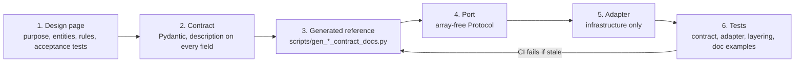

# Docs-first design

A page in `docs/` is the **design source**. Code follows it, never the other way round.

## Principles

1. **The page states the rule before the code enforces it.** Every validator in a contract traces to a sentence on its design page.
2. **Every field has a description.** The generated reference is built from those descriptions; CI fails on a missing one or a stale file.
3. **Application code is array-free.** NumPy and other numeric libraries live only under `src/app/infrastructure`. Tensors cross ports as `TensorRef` (spec, key, shape, SHA-256), never as arrays.
4. **Examples run.** Code blocks starting with `>>>` in design pages are doctests and run in CI.
5. **Status is explicit.** Each page says what is implemented, what is a port only, and what is not claimed.
6. **Evidence beats inference.** A reading carries its envelope: source and version, mapping, configuration, method and tolerances, validity, and the run that produced it. Simulated and computed results are typed differently and never mixed silently.
7. **Nothing grants authority by existing.** A record, a gate entry or a model score never releases work. Only a human decision with recorded authority and evidence does.

## Obsidian conventions

- YAML frontmatter on every page (`title`, `version`, `tags`, optional `status`).
- Callouts (`> [!note]`, `> [!warning]`) for status and limits.
- `mermaid` blocks for diagrams. Quote node labels: `A["label"]`.
- Relative Markdown links (`[Gauge](pipelines/GAUGE_PIPELINE.md)`) instead of wikilinks, so GitHub renders them too.
- Math in `$...$` or `$$...$$` (Obsidian renders MathJax).
- No enterprise identifiers, internal URLs or customer names. Company-specific vocabulary maps live outside the public tree (see [DATA_POLICY](../DATA_POLICY.md)).

## Adding a slice

1. Write `docs/<area>/<NAME>.md` with purpose, entities, rules, acceptance tests and limits.
2. Add contracts with a description on every field and a `CONTRACTS` tuple.
3. Register the contracts in `scripts/gen_agency_contract_docs.py` and run it.
4. Add the port, then the adapter under `infrastructure/`.
5. Add tests: contract rules, adapter behaviour, layering, and the doc's doctests.
6. Add the package to `pyproject.toml` and the release allowlist in `scripts/check_release.py`.
