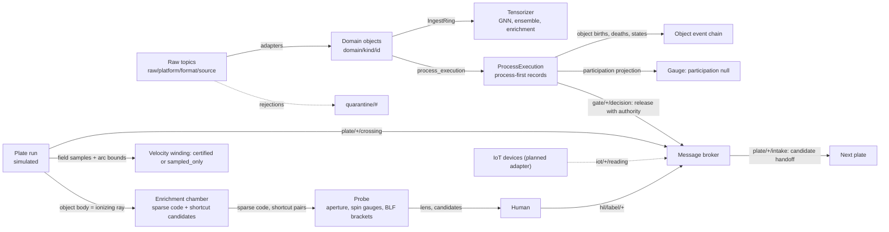

# Currentcraft docs

Currentcraft was previously developed as DataMesh; pages written before the rename keep that name.

Open this folder as an Obsidian vault (or a folder inside one). Diagrams are `mermaid` code blocks, which Obsidian renders natively. Links are relative Markdown links, so they also work on GitHub.

> [!important] Purpose
> Dashboards that give people on complex systems-integration projects **positive liberty**: practical understanding, feasible choices, and the decision rights to act. The mathematics here are exploratory lenses, not validated process facts.

## Start here

- [0.10.0 final governance blocker](releases/0.10.0-governance-blocker.md): OPEN; closure criteria, future implementation gates and final publication sign-off.

- [0.10.0 candidate record](releases/0.10.0.md): exact-run evidence, versions/digests and outstanding private scan; not a published release.

- [Document API prerequisites](architecture/API_PREREQUISITES.md): merged identity, inbox and quarantine groundwork.

- [Local NATS + PostgreSQL stack](architecture/LOCAL_COMPOSE.md): Compose setup, smoke test and local file publication.

- [Docs-first design](DOCS_FIRST.md): how a change moves from a page to code.

- [Roadmap](ROADMAP.md): implemented candidate scope versus explicitly deferred work.

## Design sources (written before code)

| Page | Slice | Status |
| --- | --- | --- |
| [Synthetic models and evidence](pipelines/MODELS_EVIDENCE.md) | `app.application.models` | synthetic contracts and pure association checks; no sanitizer or training |
| [Hierarchical evidence chunks](architecture/EVIDENCE_CHUNKS.md) | `app.application.evidence` | contracts only; extraction and persistence not implemented |
| [Process-first domain](domain/PROCESS_FIRST.md) | `app.application.process` | implemented 0.5.0 |
| [Plate and spatial isosceles](pipelines/PLATE_ISOSCELES.md) | `app.application.plate`, `app.infrastructure.plate` | implemented 0.5.0 |
| [Stochastic port-Hamiltonian systems](pipelines/STOCHASTIC_PORT_HAMILTONIAN.md) | research note for the plate slice | research only; not implemented |
| [Refinement and power-port harmonization](domain/REFINEMENT_PORT_HARMONIZATION.md) | 0.11 versioned feature graph vocabulary | proposed; coordinator decisions recorded 2026-11-21 |
| [Embedding enrichment](pipelines/EMBEDDING_ENRICHMENT.md) | `app.application.enrichment`, `app.infrastructure.enrichment` | implemented 0.6.0; geometry-only rays |
| [Probe](pipelines/PROBE.md) | `app.application.probe`, `app.infrastructure.probe` | implemented 0.7.0 (backend only) |
| [Domain scaffold](domain/DOMAIN_SCAFFOLD.md) | `app.domain` | remaining placeholders plus V1.1 capture proposals |
| [L-system domain vocabulary](domain/LSYS_DOMAIN_VOCABULARY.md) | `app.application.lsys`, `app.infrastructure.lsys` | loader and bounded growth implemented; every production a candidate; no matching or 0.13.0 grammar features |
| [Needs and scope](domain/NEEDS_AND_SCOPE.md) | `app.domain.estimation`, `Subsystem.location_id` | implemented capture proposal; not in snapshot, persistence or API |
| [Framework profiles over domain objects](domain/FRAMEWORK_PROFILES.md) | framework profiles, `app.infrastructure.enterprise` loader pattern | proposed; synthetic standard example only; real profiles private |
| [Enterprise review corrections](domain/V1_REVIEW_CORRECTIONS.md) | `app.application.enterprise`, `app.domain` | confirmed requirements, proposed encodings and validation matrix |
| [P4 design contracts](domain/P4_DESIGN_CONTRACTS.md) | `app.application.p4`, `app.domain` (workflow, quality) | reviewable domain contracts and reuse map; no orchestration or production publication |
| [P4 integration plan](architecture/P4_INTEGRATION.md) | `app.application.p4`, persistence, messaging | planned only: transaction boundaries, delivery and recovery |
| [Drawing and document lifecycle](domain/DOCUMENT_LIFECYCLE.md) | `app.domain.document` | corrected accepted requirements for 0.11.0; implementation pending |
| [Drawing controlled release](domain/DRAWING_CONTROLLED_RELEASE.md) | separate Drawing aggregate | accepted option 2; proposed described fields; not implemented |
| [Evaluation harness](architecture/EVALUATION.md) | `app.application.evaluation` | contracts and metrics 0.11.0; benchmark runner not implemented |
| [Release ladder](domain/RELEASE_LADDER.md) | `app.application.ladder` | contracts and transition table 0.13.0; authority verification and persistence not implemented |
| [Challenge and appeal route](architecture/CHALLENGE_APPEAL.md) | agency review and release consequences | proposed 0.15.0 design only; identity, authority and canonical decision integration remain open |
| [Domain boundary](architecture/DOMAIN_BOUNDARY.md) | all layers | Pydantic approved; deterministic domain |
| [XLSX workbook](pipelines/XLSX_WORKBOOK.md) | `app.application.ingest.workbook`, `app.infrastructure.ingest.xlsx` | implemented 0.9.1; source occurrences, reviewed promotion |
| [Sparse phase splice](pipelines/SPARSE_PHASE_SPLICE.md) | `app.application.splice`, `app.infrastructure.splice` | implemented 0.9.7; hashing features, junctions are candidates |
| [HFGT capability graph](pipelines/HFGT_CAPABILITY_GRAPH.md) | `app.application.hfgt`, `app.infrastructure.hfgt` | implemented 0.9.9; structural reading, encoder deferred |
| [Domain dependency graph](domain/DOMAIN_DEPENDENCY_GRAPH.md) | `app.domain` | proposed build order 0.9.1 |
| [Ingestion](architecture/INGESTION.md) | `app.application.ingest`, `app.infrastructure.ingest` | implemented 0.8.0; hashing features, not an embedding model |
| [JetStream broker adapter](architecture/JETSTREAM.md) | `app.application.messaging.durable`, `app.infrastructure.messaging.jetstream`, `app.application.ingest.durable` | implemented 0.9.3; server integration gated |
| [Persistence](architecture/PERSISTENCE.md) | `app.application.persistence`, `app.infrastructure.persistence` | implemented 0.9.2; PostgreSQL 18 SQL, proven only by the postgres-18 CI job |
| [Message broker](architecture/MESSAGE_BROKER.md) | `app.application.messaging`, `app.infrastructure.messaging` | in-memory adapter 0.5.0; MQTT/IoT adapter planned |
| [HTTP API](architecture/HTTP_API.md) | `app.interfaces.http` | bounded intake/status and privacy-safe reads; candidate live smoke recorded separately |
| [HTTP documents](architecture/HTTP_DOCUMENTS.md) | `app.application.queries`, `app.interfaces.http` | allowlist reads, bounded intake and durable opaque receipts; see candidate evidence limits |
| [CNN to GNN pipeline](pipelines/CNN_GNN_PIPELINE.md) | `app.application.simulation` | stages 1 to 4 |
| [Gauge pipeline](pipelines/GAUGE_PIPELINE.md) | `app.application.gauge` | research instrument |
| [Geodesic probe](pipelines/GEODESIC_PROBE.md) | `app.application.gauge.geodesic` | research instrument |
| [Velocity winding](pipelines/VELOCITY_WINDING.md) | `app.application.gauge.winding` | sampled vs certified |

## Generated references (never edit by hand)

- [Models and evidence contracts](contracts/MODELS_EVIDENCE_CONTRACTS.md): synthetic captures, manifests and assessments

- [Evidence contracts](contracts/EVIDENCE_CONTRACTS.md): hierarchical chunks and provenance

- [Agency contracts](contracts/AGENCY_CONTRACTS.md): process, plate, messaging, enrichment, probe, ingestion, persistence, splice, hfgt
- [Readiness contracts](contracts/READINESS_CONTRACTS.md): evaluation, release ladder, L-system grammar
- [Persistence schema](contracts/PERSISTENCE_SCHEMA.md): PostgreSQL 18 DDL from the migrations
- [Domain scaffold](contracts/DOMAIN_SCAFFOLD.md)
- [Gauge contracts](contracts/GAUGE_CONTRACTS.md)
- [Simulation contracts](contracts/SIMULATION_CONTRACTS.md)
- [OpenAPI contract](contracts/OPENAPI.json): document API including intake/status and privacy-safe read routes

## How the slices connect

- [Unreferenced-object deletion review](architecture/DELETION_REVIEW.md): persisted human gate; no storage executor.
