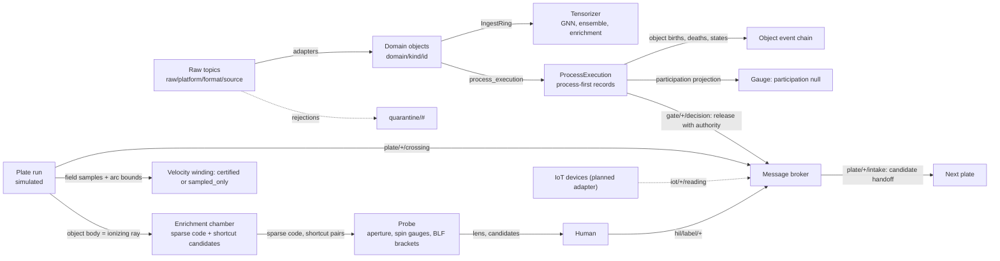

# DataMesh Agency Toolkit docs

Open this folder as an Obsidian vault (or a folder inside one). Diagrams are `mermaid` code blocks, which Obsidian renders natively. Links are relative Markdown links, so they also work on GitHub.

> [!important] Purpose
> Dashboards that give people on complex systems-integration projects **positive liberty**: practical understanding, feasible choices, and the decision rights to act. The mathematics here are exploratory lenses, not validated process facts.

## Start here

- [Local NATS + PostgreSQL stack](architecture/LOCAL_COMPOSE.md): Compose setup, smoke test and local file publication.

- [Docs-first design](DOCS_FIRST.md): how a change moves from a page to code.

- [Roadmap](ROADMAP.md): what 0.10.0 carries, including everything deferred from 0.9.9.

## Design sources (written before code)

| Page | Slice | Status |
| --- | --- | --- |
| [Process-first domain](domain/PROCESS_FIRST.md) | `app.application.process` | implemented 0.5.0 |
| [Plate and spatial isosceles](pipelines/PLATE_ISOSCELES.md) | `app.application.plate`, `app.infrastructure.plate` | implemented 0.5.0 |
| [Embedding enrichment](pipelines/EMBEDDING_ENRICHMENT.md) | `app.application.enrichment`, `app.infrastructure.enrichment` | implemented 0.6.0; geometry-only rays |
| [Probe](pipelines/PROBE.md) | `app.application.probe`, `app.infrastructure.probe` | implemented 0.7.0 (backend only) |
| [Domain scaffold](domain/DOMAIN_SCAFFOLD.md) | `app.domain` | remaining placeholders plus V1.1 capture proposals |
| [Enterprise review corrections](domain/V1_REVIEW_CORRECTIONS.md) | `app.application.enterprise`, `app.domain` | confirmed requirements, proposed encodings and validation matrix |
| [Domain boundary](architecture/DOMAIN_BOUNDARY.md) | all layers | Pydantic approved; deterministic domain |
| [XLSX workbook](pipelines/XLSX_WORKBOOK.md) | `app.application.ingest.workbook`, `app.infrastructure.ingest.xlsx` | implemented 0.9.1; source occurrences, reviewed promotion |
| [Sparse phase splice](pipelines/SPARSE_PHASE_SPLICE.md) | `app.application.splice`, `app.infrastructure.splice` | implemented 0.9.7; hashing features, junctions are candidates |
| [HFGT capability graph](pipelines/HFGT_CAPABILITY_GRAPH.md) | `app.application.hfgt`, `app.infrastructure.hfgt` | implemented 0.9.9; structural reading, encoder deferred |
| [Domain dependency graph](domain/DOMAIN_DEPENDENCY_GRAPH.md) | `app.domain` | proposed build order 0.9.1 |
| [Ingestion](architecture/INGESTION.md) | `app.application.ingest`, `app.infrastructure.ingest` | implemented 0.8.0; hashing features, not an embedding model |
| [JetStream broker adapter](architecture/JETSTREAM.md) | `app.application.messaging.durable`, `app.infrastructure.messaging.jetstream`, `app.application.ingest.durable` | implemented 0.9.3; server integration gated |
| [Persistence](architecture/PERSISTENCE.md) | `app.application.persistence`, `app.infrastructure.persistence` | implemented 0.9.2; PostgreSQL 18 SQL, proven only by the postgres-18 CI job |
| [Message broker](architecture/MESSAGE_BROKER.md) | `app.application.messaging`, `app.infrastructure.messaging` | in-memory adapter 0.5.0; MQTT/IoT adapter planned |
| [CNN to GNN pipeline](pipelines/CNN_GNN_PIPELINE.md) | `app.application.simulation` | stages 1 to 4 |
| [Gauge pipeline](pipelines/GAUGE_PIPELINE.md) | `app.application.gauge` | research instrument |
| [Geodesic probe](pipelines/GEODESIC_PROBE.md) | `app.application.gauge.geodesic` | research instrument |
| [Velocity winding](pipelines/VELOCITY_WINDING.md) | `app.application.gauge.winding` | sampled vs certified |

## Generated references (never edit by hand)

- [Agency contracts](contracts/AGENCY_CONTRACTS.md): process, plate, messaging, enrichment, probe, ingestion, persistence, splice, hfgt
- [Persistence schema](contracts/PERSISTENCE_SCHEMA.md): PostgreSQL 18 DDL from the migrations
- [Domain scaffold](contracts/DOMAIN_SCAFFOLD.md)
- [Gauge contracts](contracts/GAUGE_CONTRACTS.md)
- [Simulation contracts](contracts/SIMULATION_CONTRACTS.md)

## How the slices connect

- [Unreferenced-object deletion review](architecture/DELETION_REVIEW.md): persisted human gate; no storage executor.
