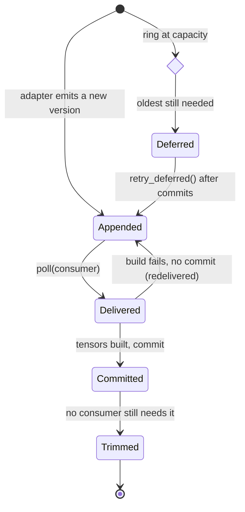

# Ingestion: from raw topics to tensors

> [!note] Names
> The **buffer ring** of the ingestion design is `IngestRing` in code. It is not the simulator's `BufferRing` (a tracer orbit) and not a project buffer (a resource at a location). One word, three concepts: the code keeps them apart.

## The path

External data takes **four transforms** before any model sees it. Each one is a boundary with its own contract:

```mermaid
flowchart LR
  subgraph RAW["1. Raw topics (hierarchical)"]
    R1["raw/platform/format/source_id"]
  end
  subgraph ACL["2. Adapters: anti-corruption layer"]
    A1["email"]
    A2["docx"]
    A3["pdf (optional)"]
    A4["json + mapping"]
    A5["data contract"]
    A6["text"]
  end
  subgraph DOM["3. Domain records"]
    D1["DomainObject<br/>object, relations, resources as pseudonyms, provenance"]
  end
  subgraph RING["4. IngestRing (buffer ring)"]
    G1["bounded, per-consumer cursors<br/>backpressure, never silent drops"]
  end
  subgraph TEN["5. Tensor plans"]
    T1["text features"]
    T2["numeric + mask"]
    T3["typed edges"]
    T4["frozen projection: positions"]
  end
  subgraph USE["6. Consumers"]
    C1["fluid: enrichment, probe"]
    C2["GNN"]
    C3["ensemble"]
    C4["CNN: via simulated fields"]
    C5["three-body: load mapping blocked on B2"]
  end
  RAW --> ACL --> DOM --> RING --> TEN --> USE
  ACL -.->|"rejections"| Q["quarantine/platform/format/source_id"]
```

## 1. Raw topics

A raw item is published to `raw/<platform>/<format>/<source_id>`, so subscriptions select at any level of the hierarchy:

| Subscription | Selects |
| --- | --- |
| `raw/#` | everything |
| `raw/sharepoint/#` | one platform, every format |
| `raw/+/pdf/#` | one format, every platform |
| `raw/outlook/email/+` | one platform and format |

The raw event carries only the content's store key, SHA-256, size and media type. **Raw bytes never travel on the broker and never enter application code**: they sit in a blob store and only adapters read them.

## 2. Adapters (anti-corruption layer)

An adapter turns one raw item into domain objects, or into a `Rejection` with a reason (published under `quarantine/...`). Adapters are deterministic: the same bytes give the same objects and ids.

| Format | Reads | Produces |
| --- | --- | --- |
| `email` | RFC 5322 message (stdlib) | message object; sender and recipients as pseudonymous resources; `reply_to` relation |
| `docx` | `word/document.xml`, `docProps/core.xml` (stdlib zip + XML) | document object; author as pseudonymous resource |
| `xlsx` | SpreadsheetML package via a declared `WorkbookProfile` (stdlib zip + XML); `RawItem.binding` ties it to a project or opportunity; see [XLSX_WORKBOOK.md](../pipelines/XLSX_WORKBOOK.md) | project document + revision, WBS phases and tasks with hierarchy codes, task x role demand, BOM lines and part-number claims, catalogs, vocabularies, diagnostics |
| `pdf` | page text and metadata (optional `pypdf`) | document object; rejected with a reason when the extractor is not installed |
| `json` | platform JSON through a declared `JsonMapping` | object with mapped fields and typed relations |
| `data_contract` | JSON validated against a registered contract | `ProcessExecution` becomes a `process_execution` object with object relations and resources; other contracts are flattened |
| `text` | UTF-8 | text object |

**People are never objects.** Email addresses, authors and executors become `ResourceRef`s with a salted pseudonymous token. The salt is configuration, never published.

## 3. Domain records

`DomainObject` = deterministic `object_id`, `kind`, title, bounded text, flat scalar fields, typed relations (with evidence), pseudonymous resources, optional real timestamp, and `Provenance` (platform, format, source id, content SHA-256, adapter and version, received time). Status is `computed`: it came from a record, not a model.

## 4. IngestRing (the buffer ring)

- **Bounded.** `capacity` entries; offsets increase forever.
- **Per-consumer cursors.** Each consumer polls from its own cursor and commits after it has used a batch. Uncommitted entries are redelivered (at least once).
- **Backpressure, never silent drops.** An entry is trimmed only when no registered consumer still needs it: every consumer has committed past it, or reads other kinds. A consumer that filters kinds never pins entries it will not read. When the ring is full and the oldest entry is still needed, `append` raises `RingFull`.
- **Deferred intake.** The pipeline turns `RingFull` into a deferral, not a dead letter: the raw item joins `pipe.deferred`, `receive` raises `RingFull` to the producer, and later intake queues behind it so order holds. After consumers commit, `retry_deferred()` resumes in order. A retry is safe because appends are idempotent.
- **Idempotent.** An object version's digest excludes intake time, so re-ingesting identical bytes later is a no-op; a changed object with the same id is a new version entry. Overlapping subscriptions process a raw event once.
- **Lag gauge.** `lag(consumer)` = entries of that consumer's kinds appended and not yet committed.

## 5. Tensor plans

A `ConsumerSpec` names the record kinds it reads and a `TensorPlan`. The tensorizer turns a polled batch into a `TensorBatch` of `TensorRef`s in the shared store:

| Tensor | Shape | Meaning |
| --- | --- | --- |
| `text` | (B, D) float32 | signed feature hashing of title + text tokens, log term frequency, L2-normalised |
| `numeric` | (B, F) float64 | declared numeric fields; `numeric_mask` (B, F) bool marks presence (missing is not zero) |
| `edge_index` | (2, E) int64 | typed relations whose target is in the batch (PyG convention: source row 0) |
| `edge_type` | (E,) int64 | index into the plan's relation types |
| `positions` | (B, 3) float64 | frozen projection of `text` (only if the plan names one) |

**Frozen projection.** `fit_projection` fits PCA once on an explicit fit set and returns a versioned `FrozenProjection` (components, mean, fit ids, explained and **discarded** variance share, digest). Batches only **apply** it; nothing refits implicitly. These positions are what the fluid, enrichment and probe slices take as their frozen 3D projection.

Every batch carries **lineage**: offsets, object ids, each row's content SHA-256, plan digest and projection digest.

> [!warning] Hashing is not an embedding model
> Feature hashing is a deterministic, model-free stand-in so the pipeline runs end to end. Semantic embeddings come from an `EmbeddingModelPort` (planned) whose model, version and space go into provenance like any other transform.

## 6. Consumers

| Consumer | Takes | Status |
| --- | --- | --- |
| fluid (enrichment, probe) | `positions` from a frozen projection | implemented |
| GNN | `text` + `edge_index` + `edge_type` | tensors implemented; encoder port planned |
| ensemble | `text` + `numeric` | tensors implemented; models planned |
| CNN | simulated field slices from the plate and fluid slices | not fed from the ring directly |
| three-body | object-mass events from gate load | **blocked**: needs an approved B2 mapping of which records are load |

## Contracts

| Contract | Role |
| --- | --- |
| `BlobRef`, `RawItem` | content handle and raw intake with its topic |
| `Provenance`, `ResourceRef`, `TypedRelation`, `DomainObject` | domain record |
| `Rejection` | quarantined input with a reason |
| `JsonMapping`, `IngestConfig` | platform mapping; pseudonym salt and limits |
| `RingEntry`, `ConsumerSpec`, `TensorPlan` | ring and plans |
| `FrozenProjection`, `TensorBatch` | tensors with lineage |

Ports: `BlobStorePort`, `SourceAdapterPort`, `TensorizerPort`. Services: `IngestPipeline` (subscribes to raw patterns, routes to adapters, appends to the ring, publishes domain and quarantine events), `IngestRing`, `TensorService` (poll, build, commit).

## Acceptance tests

1. Hierarchical subscriptions select exactly the platform or format they name.
2. Each adapter parses a synthetic sample; addresses never appear in domain objects, only salted tokens; the same bytes give the same ids.
3. Malformed input becomes a quarantined rejection, never a partial object.
4. Ring: full ring with an uncommitted oldest entry raises `RingFull`; committed entries are trimmed; a kind-filtered consumer never pins other kinds; uncommitted entries are redelivered; identical re-ingest (even later) is a no-op; lag is exact; deferred intake retries in order with no dead letters.
5. Tensorizer: hashing is deterministic; missing numeric fields are masked, not zero; edges only connect objects in the batch.
6. Frozen projection: applying it never changes it; discarded variance is reported; the same fit gives the same digest.
7. A tensor batch's lineage traces every row back to its content SHA-256.

## Example (doctest)

>>> import sys; sys.path.insert(0, "src")
>>> from datetime import datetime, timezone
>>> from app.application.ingest import ConsumerSpec, IngestConfig, JsonMapping, TensorPlan
>>> from app.infrastructure.ingest import build_ingest, put_raw
>>> when = datetime(2026, 11, 12, 8, 0, tzinfo=timezone.utc)
>>> mapping = JsonMapping(name="tasks", kind="work_item", id_field="id", title_field="name", text_fields=("description",),
...                       numeric_fields={"points": "points"}, relation_fields={"blocks": "blocks"})
>>> pipe = build_ingest(IngestConfig(pseudonym_salt="synthetic-salt-0123456789"), mappings=(mapping,), capacity=100)
>>> for i, (name, blocks) in enumerate([("Pull wire list", ["t2"]), ("Bench test rack", []), ("Issue construction release", ["t1"])]):
...     body = {"id": f"t{i}", "name": name, "description": "rack wire bench", "points": i + 1, "blocks": blocks}
...     _ = pipe.receive(put_raw(pipe, platform="tracker", fmt="json", source_id=f"t{i}", received_at=when, json_body=body, mapping="tasks"))
>>> [e.topic.split("/")[1] for e in pipe.broker.replay("domain/#")]
['work_item', 'work_item', 'work_item']
>>> tensors = pipe.tensors(ConsumerSpec(name="gnn", kinds=("work_item",), plan=TensorPlan(name="gnn", text_dim=64,
...                                    numeric_fields=("points",), relation_types=("blocks",))))
>>> batch = tensors.next_batch("gnn")
>>> pipe.store.get(batch.text).shape, pipe.store.get(batch.edge_index).tolist()
((3, 64), [[0, 2], [2, 1]])
>>> pipe.ring.lag("gnn")
0

## Limits

- Feature hashing is model-free and collides by design; it is plumbing, not meaning.
- The PDF adapter needs the optional `pdf` extra; scanned PDFs need OCR, which is not included.
- Email bodies and document text can still contain personal data. Pseudonymisation covers headers and authors only; classification review applies before anything leaves the private boundary.
- The in-memory ring and blob store are for tests and notebooks. Persistence and retention are ports to implement.

## Durable network intake (0.9.3)

The original local pipeline above remains unchanged. For network intake use `build_durable_ingest`: shared blob references -> JetStream -> source adapters -> PostgreSQL source repositories + inbox marker + outbox in one transaction -> acknowledgment. No process-local ring is treated as durable storage. See [JetStream adapter](JETSTREAM.md).
