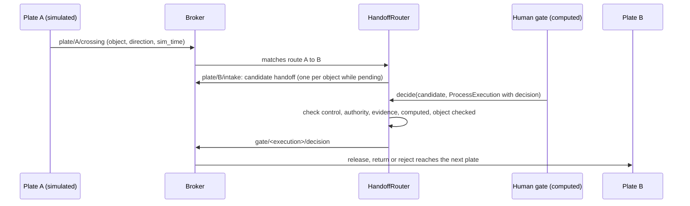

# Message broker

> [!note] Status
> The synchronous `MessageBrokerPort` and in-memory adapter serve local simulation. Version 0.9.3 adds a **separate asynchronous durable port and NATS JetStream adapter**: [durable broker architecture](JETSTREAM.md). MQTT edge bridging is still planned, not implemented.

## Why a broker

A system of systems cannot be computed as one space. Plates, gates, processes and devices each run on their own; what connects them is **events**. The broker carries those events between slices without any slice importing another's internals.

## Envelope

Every message is an `EventEnvelope`:

| Field | Rule |
| --- | --- |
| `event_id` | content hash (SHA-256) from `make_event`; publishing the same event twice is a no-op |
| `topic` | `/`-separated levels, no wildcards when publishing |
| `kind` | `plate.run`, `plate.crossing`, `object.handoff`, `gate.decision`, `object.lifecycle`, `iot.reading`, `hil.label`, `raw.item`, `domain.object`, `domain.stored`, `ingest.rejection` |
| `epistemic_status` | `computed` requires a real `occurred_at`; `simulated` requires `sim_time` |
| `payload` | flat JSON scalars only. Tensors travel as store key + SHA-256, never as arrays |
| `correlation_id`, `causation_id` | trace a chain: crossing, then candidate handoff, then gate decision |

## Topics

MQTT-style, so the IoT adapter maps one to one. Subscribe patterns use `+` (one level) and `#` (rest, last level only).

| Topic | Kind | Producer |
| --- | --- | --- |
| `plate/<plate_id>/run` | `plate.run` | `PlateService` |
| `plate/<plate_id>/crossing` | `plate.crossing` | `PlateService` |
| `plate/<plate_id>/intake` | `object.handoff` | `HandoffRouter` (candidate) |
| `gate/<execution_id>/decision` | `gate.decision` | `HandoffRouter.decide` |
| `hil/label/<record\|cluster\|pair>` | `hil.label` | `LabelBook` (probe), computed, real timestamp |
| `object/<object_id>/lifecycle` | `object.lifecycle` | process slice (planned publisher) |
| `iot/<device_id>/<reading>` | `iot.reading` | IoT adapter (planned) |
| `raw/<platform>/<format>/<source_id>` | `raw.item` | `IngestPipeline.receive` (bytes stay in the blob store) |
| `domain/<kind>/<object_id>` | `domain.object` | `IngestPipeline` after an adapter, once per new object version |
| `stored/<kind>/<object_id>` | `domain.stored` | persistence outbox relay, once per committed object version ([Persistence](PERSISTENCE.md)) |
| `quarantine/<platform>/<format>/<source_id>` | `ingest.rejection` | `IngestPipeline` when an adapter rejects input |

## Handoff between plates

Rules:

1. A crossing on a simulated plate creates at most one **candidate** handoff per object and route while one is pending. Later crossings while pending are ignored, not stacked.
2. Only `decide()` resolves a candidate, and only with a `ProcessExecution` that carries a decision and `checks` or `transfers` the same object. Release additionally needs authority, verification evidence and `computed` status (enforced by the process contracts).
3. The decision envelope is `computed`, timestamped by the execution's `occurred_at`, and caused by the candidate.

## Delivery semantics (in-memory adapter)

- Append-only log with offsets; `replay(pattern, from_offset)` rebuilds any event chain deterministically.
- Synchronous delivery in subscription order. Events published by a handler are queued and delivered after the current one (FIFO), so order is stable.
- Idempotent: duplicate `event_id`s are dropped.
- A failing handler does not stop delivery; the event and error go to `dead_letters`.

## IoT adapter (planned)

An MQTT adapter implements `MessageBrokerPort` in `app.infrastructure.messaging`, maps topics unchanged, serialises envelopes as JSON, and must preserve `event_id` dedupe and the computed/simulated timestamp rules. Device readings arrive as `iot.reading` with `computed` status and a device timestamp. No MQTT client is bundled; the runtime dependency set stays NumPy + Pydantic.

## Example (doctest)

>>> import sys; sys.path.insert(0, "src")
>>> from datetime import datetime, timezone
>>> from app.application.messaging import HandoffRouter, Route
>>> from app.application.plate import IsoscelesParams, PlateRunRequest
>>> from app.application.process import AuthorityRef, CapabilityBinding, ObjectIncidence, ProcessExecution, ProcessType
>>> from app.infrastructure.plate import build_numpy_plate
>>> service, store, broker = build_numpy_plate()
>>> router = HandoffRouter(broker, routes=(Route(from_plate="plate-a", to_plate="plate-b", direction=-1),))
>>> run = service.run(PlateRunRequest(plate_id="plate-a", object_id="obj-1", params=IsoscelesParams(), steps=6000))
>>> intake = broker.replay("plate/plate-b/intake")
>>> len(intake), intake[0].payload["status"], intake[0].epistemic_status
(1, 'candidate', 'simulated')
>>> gate = ProcessType(code="gate", name="Handoff gate", function_classes=("control",))
>>> execution = ProcessExecution(execution_id="demo:gate:1", process=gate, stage="S3",
...     occurred_at=datetime(2026, 11, 12, 9, 0, tzinfo=timezone.utc),
...     incidence=(ObjectIncidence(object_id="obj-1", effect="checks", state_after="released"),
...                ObjectIncidence(object_id="obj-receipt", effect="reads")),
...     executed_by=(CapabilityBinding(resource_id="res-coordinator", resource_role="coordinator"),),
...     decision="release", verification_evidence=("obj-receipt",),
...     authority=AuthorityRef(holder_role="handoff-approver", scope="release"))
>>> decision = router.decide(intake[0].event_id, execution)
>>> decision.topic, decision.epistemic_status, decision.payload["decision"]
('gate/demo:gate:1/decision', 'computed', 'release')
>>> router.pending()
()
