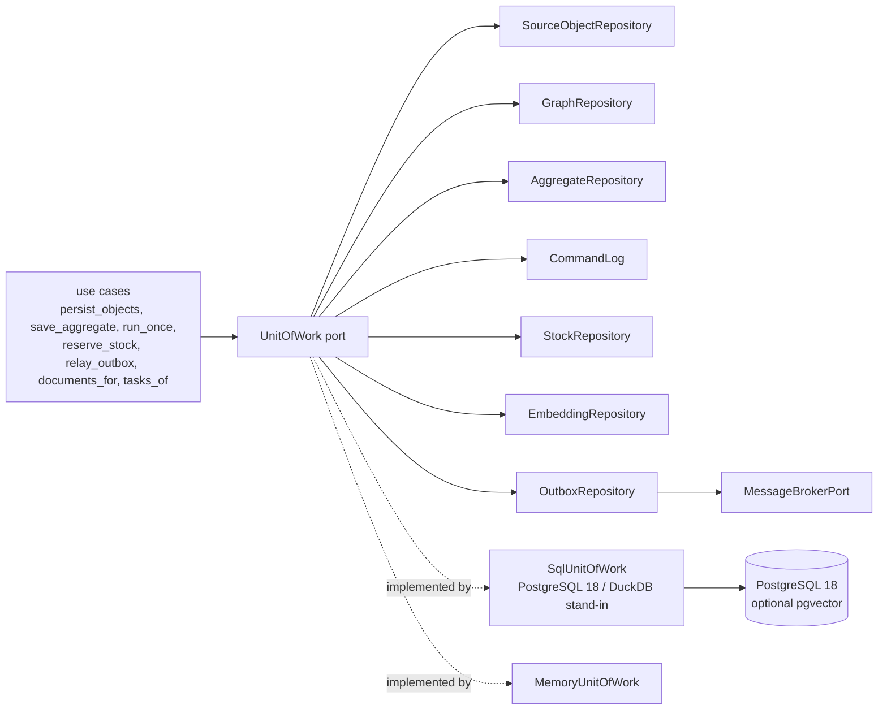

# Persistence

> [!warning] Status
> Ports, contracts, use cases, migrations and the SQL repositories are implemented. The SQL is written for **PostgreSQL 18**. CI runs the shared contract suite against memory and a **DuckDB stand-in** that executes the same statements. The stand-in proves statements and semantics, **not PostgreSQL compatibility**. `PostgresContract` runs only when `DATAMESH_PG_DSN` points at a server and `psycopg` 3 is installed; a release may claim PostgreSQL support only after that suite has passed against PostgreSQL 18.

## Shape



- **Domain** (`app.domain`) never imports persistence. Aggregates are stored as `model_dump(mode="json")`: Decimals stay exact strings.
- **Application** (`app.application.persistence`): Pydantic contracts, `Protocol` ports, use cases. No drivers, SQL, `json` or numpy (layering test).
- **Infrastructure** (`app.infrastructure.persistence`): dialects, migrations, SQL repositories, in-memory repositories, wiring. Only `wiring.py` imports a driver, lazily.

## Unit of work

One unit of work = one transaction on one connection. Connections are autocommit; the executor issues `BEGIN ISOLATION LEVEL READ COMMITTED` / `COMMIT` / `ROLLBACK` itself. Leaving the block without `commit()` rolls back. Constraint and serialization failures surface as `VersionConflict`: reload and retry, never overwrite.

## What is stored

| Repository | Table(s) | Rule |
| --- | --- | --- |
| Source objects | `dm_source_objects`, `dm_source_object_heads` | Every new digest is a new version; the same digest is a no-op (matches IngestRing). Body is the full `DomainObject` as JSONB. |
| Graph | `dm_edges` | Typed relations stored per source version, with evidence. Reads join the heads table, so a relation dropped in a later version is no longer current. Traversal is a recursive CTE, depth 1..6, cycle-safe, shortest depth reported. Targets may not be stored yet. |
| Aggregates | `dm_aggregates`, `dm_aggregate_versions` | Opaque UUID identity, monotonic version, compare-and-swap on `expected_version` (`None` = create). Full history kept. |
| Commands | `dm_commands` | Idempotency key per command. `run_once` returns the first outcome on replay and does nothing. |
| Stock | `dm_stock_positions`, `dm_reservations` | `NUMERIC(38,12)`. A reservation is one conditional `UPDATE ... WHERE reserved + qty <= on_hand`; under READ COMMITTED a competing writer re-checks after the first commits, so stock is never overcommitted. `CHECK (reserved <= on_hand)` backs it up. Reserve and release are idempotent. A reservation is a claim, not an approval, purchase or custody transfer. |
| Embeddings | `dm_embeddings` | Dense values + presence mask, sparse indices + values, keyed by model name and version; dimension and precision checked on read. Round trip within the precision's tolerance. Optional pgvector columns (migration 101) take `vector` / `sparsevec`. |
| Outbox | `dm_outbox` | `domain.stored` events written in the same transaction as the change; `relay_outbox` publishes after commit and marks them. At least once: the broker drops duplicate `event_id`s. |

## Rules that do not bend

- Every value is a bound parameter. `{TOKENS}` in statements are fixed type names from `dialect.py`, never data.
- Quantities and money are `Decimal` end to end; never float.
- Timestamps are timezone-aware; naive input is refused.
- Sparse indices are **zero-based** in the application and **one-based** in pgvector `sparsevec`; conversion happens only in `vectors.py`.
- Vectors from different model identities are never compared.
- Stored source occurrences are evidence, not accepted domain entities; promotion into `app.domain` stays a reviewed step.

## Project documents

The estimation workbook path from [XLSX workbook](../pipelines/XLSX_WORKBOOK.md) persists unchanged: `documents_for(subject)` follows `document_of` into the project or opportunity reference; `tasks_of(document)` returns `wbs_task` occurrences `extracted_from` the document and, by default, only those `in_revision` of its `current_revision`. Re-ingesting the same workbook stores nothing new.

## Wiring

```python
from app.infrastructure.persistence import build_postgres, build_memory
uow = build_postgres("postgresql://...", pgvector=False)   # pip install 'datamesh-agency-toolkit[postgres]'
persist_objects(uow, result.objects, at=now)
```

`build_postgres` opens one connection per unit of work; put a pool behind `connect` for production. Migrations are ordered, idempotent and recorded in `dm_schema_migrations`; migration 101 needs `CREATE EXTENSION` rights and is opt-in. Generated schema: [Persistence schema](../contracts/PERSISTENCE_SCHEMA.md).

## Work-tracker projection (future)

A work tracker (for example ClickUp) is a **projection** of committed outbox events, never the authority for stock, reservations or versions.

| Event arrives | Projection does |
| --- | --- |
| duplicate (`event_id` seen) | nothing |
| stale (aggregate version <= projected version) | nothing; logs it |
| gapped (version skips ahead) | holds the event, re-reads the aggregate from the repository, then projects the current version |
| tracker edit to a projected stock or reservation field | ignored as a write; reported as a conflicting claim for review |

## Not done

- Apache AGE graph projection (edges stay relational; AGE would be a read model built from `dm_edges`).
- Row-level security, roles and retention policy.
- Async driver and connection pool wiring.
- Vector similarity queries (storage only).
- Pinned version matrix (PostgreSQL 18.x, pgvector, AGE, psycopg): recorded only after the PostgreSQL suite runs in an approved environment.

## Ubuntu service provisioning

See [Ubuntu PostgreSQL setup](UBUNTU_POSTGRES.md) for the dedicated PostgreSQL 18 service deployment script, secret handling and migration commands.
