# Domain implementation dependency graph

Proposed build order for the 94 `app.domain` scaffolds. Derived from `wireframe class diagram v2.mermaid` (356 associations, 80 inheritance) with D01 to D09 applied. Not an approved model: it orders work, it does not define entities.

## Rules used

- A depends on B when A holds the reference. For `1 → many` containment (has, contains, owns, decomposes into, history) the child holds it.
- Inheritance: child depends on parent. Six source inheritances are retired by D01 to D09 and do not count. Scaffolds still do not inherit until reviewed.
- V1 additions get proposed edges: D07/D09 ones are confirmed meaning, the rest are inferred from the V1 task and need SME review.
- A private enterprise extension class and PRJDocument (not scaffolded) are excluded from the ordering.
- Level = longest dependency chain beneath a class. Implement level 0 first; a class is unblocked once every lower dependency has an accepted definition.

## Levels

| Level | Classes |
| --- | --- |
| L00 | `Agent` *(+)*, `VersionedEntity` |
| L01 | `AdministrativeArea`, `ReferenceValue`, `StandardsOrganization`, `WBS`, `WorkflowDefinition` |
| L02 | `CostCode`, `CredentialDefinition`, `LifecycleState`, `Location`, `ReferenceSet`, `Standard` |
| L03 | `StandardEdition`, `WorkflowInstance` |
| L04 | `Contributor`, `DataProduct`, `Employee`, `Organization`, `RegulatoryJurisdiction`, `SpecificationCategory`, `StandardClause`, `Subcontractor` |
| L05 | `BoundedContext`, `Client`, `Document`, `MetricDefinition`, `QualityGateDefinition`, `Specification` |
| L06 | `ApplicationService`, `ClientDivision`, `Contract`, `DomainIntegrationContract`, `GateApprovalRequirement`, `GateCriterionDefinition`, `Manufacturer`, `QualityEvidence`, `RegulatoryAuthority`, `ReportDefinition`, `System`, `TransitionDefinition` |
| L07 | `ProductDefinition` *(+)*, `Project`, `Stakeholder`, `Vendor` |
| L08 | `AssetInstance` *(+)*, `BOM` *(+)*, `ComplianceProject`, `LaborPlatformVendor` *(+)*, `Milestone`, `Order`, `ProductOnlyVendor` *(+)*, `ProfessionalServicesManufacturerVendor` *(+)*, `QualityGateInstance`, `SubcontractorFreelancerVendor` *(+)* |
| L09 | `BOMLine` *(+)*, `GateCriterionResult`, `GateDecision`, `MilestoneSignOff`, `Phase`, `Shipment` *(+)*, `Subsystem` |
| L10 | `Drawing`, `ManufacturerRep`, `MetricObservation`, `Nonconformity`, `Product`, `Report`, `Revision`, `StateTransition`, `Task` |
| L11 | `CalendarBooking` *(+)*, `Consultant`, `CorrectiveAction`, `DataLineage`, `DistributionEvent`, `Equipment`, `RFI` *(+)*, `ReferenceDocument`, `ReviewItem`, `TimeCard`, `Tool`, `WorkItem` |
| L12 | `Approval`, `CapitalTool`, `CredentialAssignment`, `EngineeringComputer`, `IntegrationMaterial`, `LineageNode`, `RentalTool`, `SpecificationReference`, `Submittal` |
| L13 | `ComputerDeployment`, `VerificationActivity` |

## Loops to cut before implementation

| Loop | Suggested cut | Why |
| --- | --- | --- |
| Contributor ⇄ Organization ⇄ Subcontractor | Organization → Contributor (primary contact) | Forward RecordRef, or move onto a Stakeholder relationship (D04) |
| Drawing ⇄ Revision | Drawing → Revision (current revision) | Resolve current revision as a forward ref over revision history |
| ManufacturerRep ⇄ Product | Product → ManufacturerRep (supported by) | D08 puts the link on the representation record; Product is legacy |

## Redlined source inheritance

| Source edge | Status | Reason |
| --- | --- | --- |
| Employee inherits Contributor | retired | D01: Employee is not a Contributor subtype |
| Stakeholder inherits Contributor | retired | D04: Stakeholder is a contextual relationship |
| Order inherits Document | retired | D06: Order is commercial, separate from its document |
| Drawing inherits Document | open | Pending V1 decision: is a Drawing a Document? |
| Product inherits Equipment | retired | D07: Product is legacy, splits into ProductDefinition + AssetInstance |
| ManufacturerRep inherits Organization | retired | D08: representation relationship, not an org subtype |
| Consultant inherits Organization | retired | D05: consulting engagement, not an org subtype |

## Highest leverage (most downstream classes)

| Class | Level | Downstream |
| --- | --- | --- |
| `VersionedEntity` | L00 | 92 |
| `WorkflowDefinition` | L01 | 75 |
| `LifecycleState` | L02 | 74 |
| `ReferenceValue` | L01 | 72 |
| `WorkflowInstance` | L03 | 72 |
| `StandardsOrganization` | L01 | 71 |
| `Standard` | L02 | 69 |
| `StandardEdition` | L03 | 68 |
| `AdministrativeArea` | L01 | 67 |
| `Location` | L02 | 64 |
| `Contributor` | L04 | 62 |
| `Organization` | L04 | 62 |

## Graph (transitive reduction)

Only edges not implied by a longer path are drawn. Full edge list: `domain_dependency_graph.json`.

```mermaid
flowchart BT
  subgraph L00["L00"]
    Agent
    VersionedEntity
  end
  subgraph L01["L01"]
    AdministrativeArea
    ReferenceValue
    StandardsOrganization
    WBS
    WorkflowDefinition
  end
  subgraph L02["L02"]
    CostCode
    CredentialDefinition
    LifecycleState
    Location
    ReferenceSet
    Standard
  end
  subgraph L03["L03"]
    StandardEdition
    WorkflowInstance
  end
  subgraph L04["L04"]
    Contributor
    DataProduct
    Employee
    Organization
    RegulatoryJurisdiction
    SpecificationCategory
    StandardClause
    Subcontractor
  end
  subgraph L05["L05"]
    BoundedContext
    Client
    Document
    MetricDefinition
    QualityGateDefinition
    Specification
  end
  subgraph L06["L06"]
    ApplicationService
    ClientDivision
    Contract
    DomainIntegrationContract
    GateApprovalRequirement
    GateCriterionDefinition
    Manufacturer
    QualityEvidence
    RegulatoryAuthority
    ReportDefinition
    System
    TransitionDefinition
  end
  subgraph L07["L07"]
    ProductDefinition
    Project
    Stakeholder
    Vendor
  end
  subgraph L08["L08"]
    AssetInstance
    BOM
    ComplianceProject
    LaborPlatformVendor
    Milestone
    Order
    ProductOnlyVendor
    ProfessionalServicesManufacturerVendor
    QualityGateInstance
    SubcontractorFreelancerVendor
  end
  subgraph L09["L09"]
    BOMLine
    GateCriterionResult
    GateDecision
    MilestoneSignOff
    Phase
    Shipment
    Subsystem
  end
  subgraph L10["L10"]
    Drawing
    ManufacturerRep
    MetricObservation
    Nonconformity
    Product
    Report
    Revision
    StateTransition
    Task
  end
  subgraph L11["L11"]
    CalendarBooking
    Consultant
    CorrectiveAction
    DataLineage
    DistributionEvent
    Equipment
    RFI
    ReferenceDocument
    ReviewItem
    TimeCard
    Tool
    WorkItem
  end
  subgraph L12["L12"]
    Approval
    CapitalTool
    CredentialAssignment
    EngineeringComputer
    IntegrationMaterial
    LineageNode
    RentalTool
    SpecificationReference
    Submittal
  end
  subgraph L13["L13"]
    ComputerDeployment
    VerificationActivity
  end
  AdministrativeArea --> VersionedEntity
  ApplicationService --> BoundedContext
  ApplicationService --> QualityGateDefinition
  Approval --> ReviewItem
  AssetInstance --> ProductDefinition
  BOM -.-> Project
  BOMLine -.-> BOM
  BOMLine -.-> ProductDefinition
  BoundedContext --> DataProduct
  CalendarBooking -.-> Agent
  CalendarBooking -.-> Task
  CapitalTool --> Tool
  Client --> Employee
  Client --> Organization
  ClientDivision --> Client
  ComplianceProject --> Project
  ComplianceProject --> RegulatoryAuthority
  ComputerDeployment --> EngineeringComputer
  Consultant --> Drawing
  Contract --> Client
  Contract --> CostCode
  Contract --> Specification
  Contributor --> Subcontractor
  CorrectiveAction --> Nonconformity
  CostCode --> ReferenceValue
  CostCode --> WBS
  CredentialAssignment --> Consultant
  CredentialAssignment --> CredentialDefinition
  CredentialDefinition --> StandardsOrganization
  DataLineage --> Report
  DataProduct --> WorkflowInstance
  DistributionEvent --> Report
  Document --> Contributor
  DomainIntegrationContract --> BoundedContext
  DomainIntegrationContract --> MetricDefinition
  Drawing --> Revision
  Employee --> AdministrativeArea
  Employee --> ReferenceValue
  Employee --> WorkflowInstance
  EngineeringComputer --> Equipment
  Equipment --> Order
  Equipment --> Task
  GateApprovalRequirement --> QualityGateDefinition
  GateApprovalRequirement --> ReferenceValue
  GateCriterionDefinition --> QualityGateDefinition
  GateCriterionResult --> GateCriterionDefinition
  GateCriterionResult --> QualityEvidence
  GateCriterionResult --> QualityGateInstance
  GateDecision --> QualityGateInstance
  IntegrationMaterial --> Equipment
  IntegrationMaterial --> Subsystem
  LaborPlatformVendor --> Vendor
  LifecycleState --> WorkflowDefinition
  LineageNode --> DataLineage
  LineageNode --> DataProduct
  Location --> AdministrativeArea
  Location --> ReferenceValue
  Manufacturer --> Organization
  Manufacturer --> Specification
  ManufacturerRep --> Product
  MetricDefinition --> DataProduct
  MetricDefinition --> StandardClause
  MetricObservation --> MetricDefinition
  MetricObservation --> Phase
  Milestone --> Project
  MilestoneSignOff --> Document
  MilestoneSignOff --> Milestone
  MilestoneSignOff --> Stakeholder
  Nonconformity --> GateCriterionResult
  Order --> Vendor
  Organization --> Contributor
  Phase --> Milestone
  Product --> ManufacturerRep
  ProductDefinition --> Manufacturer
  ProductOnlyVendor --> Vendor
  ProfessionalServicesManufacturerVendor -.-> Manufacturer
  ProfessionalServicesManufacturerVendor --> Vendor
  Project --> ClientDivision
  Project --> Contract
  Project --> System
  QualityEvidence --> Document
  QualityGateDefinition --> StandardClause
  QualityGateInstance --> Project
  QualityGateInstance --> QualityGateDefinition
  RFI -.-> Drawing
  ReferenceDocument --> Revision
  ReferenceSet --> ReferenceValue
  ReferenceValue --> VersionedEntity
  RegulatoryAuthority --> Organization
  RegulatoryAuthority --> RegulatoryJurisdiction
  RegulatoryAuthority --> Specification
  RegulatoryJurisdiction --> AdministrativeArea
  RegulatoryJurisdiction --> ReferenceValue
  RegulatoryJurisdiction --> StandardEdition
  RentalTool --> Order
  RentalTool --> Tool
  Report --> Document
  Report --> Phase
  ReportDefinition --> MetricDefinition
  ReviewItem --> Task
  Revision --> Drawing
  Shipment -.-> AssetInstance
  Shipment -.-> Order
  Specification --> SpecificationCategory
  Specification --> WorkflowInstance
  SpecificationCategory --> ReferenceValue
  SpecificationCategory --> StandardEdition
  SpecificationReference --> ReferenceDocument
  Stakeholder --> ClientDivision
  Standard --> StandardsOrganization
  StandardClause --> StandardEdition
  StandardEdition --> Standard
  StandardsOrganization --> VersionedEntity
  StateTransition --> GateDecision
  StateTransition --> TransitionDefinition
  Subcontractor --> Organization
  SubcontractorFreelancerVendor --> Vendor
  Submittal --> Consultant
  Submittal --> RegulatoryAuthority
  Submittal --> ReviewItem
  Subsystem --> Milestone
  System --> Location
  System --> Specification
  Task --> Document
  Task --> Phase
  TimeCard --> Task
  Tool --> Task
  TransitionDefinition --> LifecycleState
  TransitionDefinition --> QualityGateDefinition
  Vendor --> Contract
  VerificationActivity --> Approval
  VerificationActivity --> ComplianceProject
  VerificationActivity --> WorkItem
  WBS --> VersionedEntity
  WorkItem --> Task
  WorkflowDefinition --> VersionedEntity
  WorkflowInstance --> LifecycleState
```

