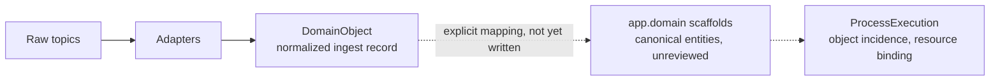

# Domain entity scaffold

> [!warning] Scaffold, not a model
> Every class here is an unreviewed placeholder. Importing one proves the namespace exists, nothing more. No business fields, permissions, lifecycles or authority are implemented.

## What is here

94 Pydantic classes under `app.domain`: 82 names from a source class model and 12 additions (product definition and asset instance, four vendor subtypes, shipment, calendar booking, BOM and BOM line, RFI, agent). The full list with paths is the generated [domain scaffold reference](../contracts/DOMAIN_SCAFFOLD.md); its source is [domain_scaffold_manifest.json](domain_scaffold_manifest.json).

Each class has exactly two fields:

| Field | Rule |
| --- | --- |
| `entity_id` | optional UUID; no default identity is invented, and business numbers are rejected |
| `definition_status` | always `unreviewed-scaffold` |

Extra fields are rejected and `require_accepted_definition()` always raises. Scaffolds never inherit from one another: sharing `ScaffoldRecord` is mechanical, not a claim that the classes share meaning.

## Where it sits

`DomainObject` (ingestion) is a normalized source record, not the root of these entities. A reviewed mapping from one to the other is future work.

## Direction already fixed by the names

- Employee and Contributor are distinct resources; neither is a subtype of the other.
- Phase is the project lifecycle phase, kept apart from the simulator's physics phase.
- Stakeholder, Consultant and ManufacturerRep are relationships or engagements, not person or organization subtypes. None grants authority by itself.
- Order is a commercial entity, separate from documents that represent it.
- Product splits into ProductDefinition and AssetInstance.
- Vendor has four subtype meanings; whether they may overlap is open.

## Rules

- Pydantic only. No NumPy, no infrastructure imports, no inheritance between scaffolds (tests enforce all three).
- A class leaves scaffold status only through a reviewed definition: meaning and kind, identity and external references, typed attributes with missing-value reasons, field authority, typed relationships, lifecycle, authority, and owned open questions.
- Enterprise-specific records are not published in this tree.

## Example (doctest)

>>> import sys; sys.path.insert(0, "src")
>>> from app.domain.product.product_definition import ProductDefinition
>>> p = ProductDefinition()
>>> p.definition_status, p.entity_id
('unreviewed-scaffold', None)
>>> p.require_accepted_definition()
Traceback (most recent call last):
NotImplementedError: ProductDefinition: definition and invariants are not implemented
