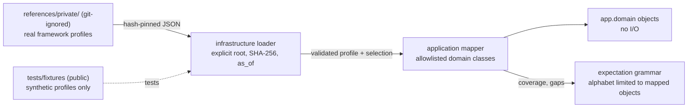

# Framework profiles over domain objects

> [!warning] Status: proposed
> A mechanism for mapping external frameworks onto domain objects, worked through a **synthetic standard**. The real frameworks, their editions, which domain each one serves and every real mapping are private reference data, held server-side and never in this repository. Nothing here claims conformity with any standard.

## Why profiles

Each domain could carry its own vocabulary, which multiplies reference surface. Instead, a small number of framework profiles is mapped onto domain objects: one profile per framework, not one per domain. A domain is reached either natively (the framework was written for it) or by mapping (a framework written for another domain reaches it). Where no mapped framework reaches far enough, a dedicated **gap framework** fills only that named gap.

## Roles and coverage

| Term | Meaning |
| --- | --- |
| primary | the one framework a domain is read through; every domain has exactly one |
| secondary | an extra framework used only where a profile lists it |
| gap | a framework that fills one named gap and nothing else; it never replaces the primary |
| `native` | the framework's concepts were written for this domain |
| `mapped` | concepts from a framework for another domain reach this domain fully |
| `mapped, partial` | they reach it with a recorded gap |
| `mapped, gap filled` | the recorded gap is filled by a gap framework |

A coverage label says how far a framework's concepts reach a domain. It is not a measure of how well the system implements the framework.

## The synthetic standard

Two synthetic frameworks stand in for real ones. Their concepts are invented for this example. Fixture: [`tests/fixtures/framework_profiles/synthetic_profiles.json`](../../tests/fixtures/framework_profiles/synthetic_profiles.json).

| Framework | Kind | Concepts |
| --- | --- | --- |
| `SYN-A` | primary framework | work container, record, part of a whole, catalog item, list of parts |
| `SYN-G` | gap framework | maturity class |

| Concept | Domain | Domain object | Role | Coverage |
| --- | --- | --- | --- | --- |
| `SYN-A.C1` work container | Projects | `Project` | primary | `native` |
| `SYN-A.C2` record | Working Docs | `Document` | primary | `mapped` |
| `SYN-A.C3` part of a whole | Subsystems | `Subsystem` | primary | `mapped` |
| `SYN-A.C4` catalog item | Inventory | `ProductDefinition` | primary | `mapped, partial` (gap: movement events) |
| `SYN-A.C5` list of parts | Inventory | `BOM` | secondary | `mapped, partial` |
| `SYN-G.C1` maturity class | Estimation / Needs Analysis | none yet | gap | `mapped, gap filled` |

What the example shows:

- One framework reaches several domains by mapping, so the profile count stays below the domain count.
- A partial mapping records its gap in words; it does not invent a domain object to close it.
- A gap framework may name a domain with no domain object yet. It then maps to nothing and lets the grammar grow nothing; it only records that the gap is covered once objects exist.

## Synthetic meta-framework test envelope

Tests and synthetic data are generated from one fictional standard: [`tests/fixtures/framework_profiles/framework.meta.synthetic.v1.json`](../../tests/fixtures/framework_profiles/framework.meta.synthetic.v1.json) (`SYNTH-META-001`, edition `TEST-1`, status `synthetic_test_only`). It models how a standard is built, not what any real standard says: identity, dated normative references, informative references, terms, clauses, annexes and notes. It confers no approval, compatibility or conformance, reproduces no source text, and is not a runtime schema or a parser for real standards.

| Element | What the tests check |
| --- | --- |
| Envelope | `synthetic: true`; authority is none; private mappings and the real catalogue are excluded |
| `meta_content_sha256` | SHA-256 of `meta_content` as sorted, compact JSON |
| Records | `ReferenceSet` and `ReferenceValue` payloads validate against the domain classes; each value points at its set |
| Scaffold rejections | the unreviewed standards scaffolds (`StandardsOrganization`, `Standard`, `StandardEdition`, `StandardClause`, `SpecificationReference`) reject fields they cannot yet capture |
| Provision kinds | verbal form matches kind: requirement `shall`, prohibition `shall not`, recommendation `should`, permission `may`, possibility and capability `can`, statement none |
| Testability | only requirements and prohibitions carry a test predicate; recommendations, permissions, possibilities, capabilities, statements, annexes and notes never execute |
| References | normative references are dated and resolved; an unresolved informative reference carries a reason |
| Generated data | toy records are checked against the testable clauses: a known marker passes, a missing or out-of-alphabet marker fails |

Acceptance: [`tests/test_synthetic_meta_framework.py`](../../tests/test_synthetic_meta_framework.py). The envelope's `mapping_status` holds: the standards scaffolds cannot capture clause, edition or reference fields yet, so that content stays in the test envelope until reviewed definitions replace the scaffolds.

## Synthetic fixtures and distribution status

This section records the source state at merge `4e1982df8dc9c36fbc352a7a10888c31cf9ac4ab` (PR #42, 2026-11-21). It documents observed coverage, not a packaging fix or acceptance of a later revision.

| Purpose | Source | Consumer |
| --- | --- | --- |
| Existing reference-object hydration | `references/public/framework.synthetic.v1.json` | `tests/integration/test_public_framework_fixture.py` |
| Public meta-framework REF envelope | `references/public/framework.meta.synthetic.v1.json` | `tests/test_synthetic_meta_ref.py` |
| Concurrent meta-framework test envelope | `tests/fixtures/framework_profiles/framework.meta.synthetic.v1.json` | `tests/test_synthetic_meta_framework.py` |
| Synthetic primary, secondary and gap mappings | `tests/fixtures/framework_profiles/synthetic_profiles.json` | `tests/test_framework_profiles.py` |
| Synthetic ownership rules bound to `SYN-A` | `tests/fixtures/framework_profiles/synthetic_ownership.json` | `tests/test_six_type_reference_resolution.py` |

The two meta-framework envelopes have equal `meta_content` at the audited merge. Their `intended_visibility` labels differ. They are separate files, and no cross-copy drift assertion currently ties their content or provenance together. Their identity fields do not establish an authoritative production reference source.

### Concurrent-work preservation

A byte-level comparison with pre-merge main `2601f057ac82a5d570594f917b4b1f85996997da` found no removed files: 668 existing files were unchanged, two were modified (`.gitignore` and `scripts/check_release.py`), and two were added (the public meta envelope and its separate test module). Existing framework documentation, privacy-boundary changes, fixture JSONs, reference hydration tests and the independently added meta-framework test module were preserved.

A focused run on the actual merged snapshot passed 76 tests with zero skips:

```sh
python -m unittest \
  tests.test_synthetic_meta_ref \
  tests.test_synthetic_meta_framework \
  tests.integration.test_public_framework_fixture \
  tests.test_framework_profiles -v
```

This is not a full-suite, runtime, installed-package or conformity claim. The suites also express missing-marker behavior differently: the REF toy evaluator preserves `unknown`, while the concurrent generated-data check records an unsatisfied boolean test. Neither produces approval; the presence of both checks is not a harmonized production evaluation policy.

### Export is not source-distribution acceptance

The fresh public ZIP exporter includes the public meta fixture after its exact release allowlist addition. That does not establish that Python packaging includes the same data.

A real `setuptools.build_meta.build_sdist` build at the audited merge showed:

| File | In source tree | In built source distribution |
| --- | --- | --- |
| `references/public/framework.synthetic.v1.json` | yes | yes |
| `references/public/framework.meta.synthetic.v1.json` | yes | **no** |
| `tests/fixtures/framework_profiles/framework.meta.synthetic.v1.json` | yes | **no** |
| `tests/fixtures/framework_profiles/synthetic_profiles.json` | yes | **no** |
| Both meta-framework test modules | yes | yes |

The consuming tests are shipped without all their required fixture inputs. This is a confirmed source-distribution omission, not evidence that the merge deleted concurrent work. Wheel data coverage and installed-package execution were not checked. `MANIFEST.in` currently names the older public framework fixture, but not the three omitted JSON files.

### Follow-up acceptance, not yet implemented

1. Add exact synthetic fixture entries to the source-distribution manifest without broadening access to private references.
2. Build and unpack a fresh source distribution, then run the focused tests from that unpacked tree, not from a checkout that can mask missing files.
3. Add a packaging regression that checks required fixtures and exclusion of private content.
4. Choose one canonical synthetic envelope with a generated copy, or add explicit cross-copy equality checks for content and an allowlist of intentional provenance differences.
5. Keep source identity, edition selection, evidence state, test satisfaction and release authority distinct. Decide any difference in missing-data interpretation explicitly; do not silently promote a toy boolean into production policy.

No manifest, fixture, loader or test behavior is changed by this documentation update. The standards scaffolds still cannot capture edition, clause or specification-reference metadata beyond their identity placeholders. Real profiles and mappings remain private server-side; source visibility, successful construction and a clean vocabulary scan do not establish public rights or approval.

## Profile shape

| Field | Rule |
| --- | --- |
| `schema` | `framework-profile/0`; a dedicated schema, separate from the enterprise reference dictionary and the path-rule projection |
| `framework_id`, `framework_edition` | opaque in public fixtures; real identifiers and editions are private |
| `kind` | `primary` or `gap` |
| `profile_version` | version of this mapping, not of the framework |
| `source_digest` | SHA-256 of the private source the mapping was built from |
| `valid_from`, `valid_to` | timezone-aware validity window |
| `concepts[]` | `concept_id`, `label`, `domain`, `maps_to` (an allowlisted domain class or `null`), `role`, `coverage`, optional `gap` |

## Ownership profiles

Ownership between canonical kinds (which kind owns which, through which owner field, and
whether it is required) is read from the referenced standard, not hard-coded. An
ownership profile has its own schema, `framework-ownership/0`, so `framework-profile/0`
stays closed. It pins one framework profile exactly (`framework_id`, `framework_edition`,
`profile_version`, `source_digest`); every rule cites a concept of that profile, and the
concept must map to the rule's subject or owner. Six-type reference resolution applies it;
see [Six concrete domain types](SIX_DOMAIN_TYPES.md#ownership-from-the-referenced-standard).
Real ownership profiles are private REF data.

## Infrastructure



| Concern | Placement | Rule |
| --- | --- | --- |
| Real profiles | `references/private/`, git-ignored, server-side | framework names, editions, mappings and clause references never enter the public tree |
| Public profiles | `tests/fixtures/` | synthetic only, opaque identifiers |
| Loading | infrastructure, following the hash-pinned pattern in `app.infrastructure.enterprise.references` with its own schema | explicit absolute root, path inside root, size limit, SHA-256 match, closed JSON, `as_of` inside the validity window |
| Mapping | application | `maps_to` must be an allowlisted domain class; no class name in a profile is imported or executed |
| Domain | `app.domain` | Pydantic only, no file access |
| Grammar | expectation grammar | grows symbols only for concepts that map to a domain object |

## Substitute ranking (generic)

A framework that models commercial exchanges can rank substitute products inside an estimate. The caveats hold for any such framework:

1. A substitute ranks only if its configuration is valid under one pinned feature-model revision.
2. Model-valid is not compatible; interface compatibility needs its own typed evidence, otherwise `unknown`.
3. Model-valid, ordered, observed installed and test-passed stay separate statuses.
4. Only configurations with source evidence rank; "not observed" is not "absent".
5. Adoption lag runs from first evidenced availability to first verified adoption; a precedent is not a transfer.
6. Sell price, cost and actuals stay distinct.
7. A rank is a candidate list; a gate decides.
8. A rank cannot claim more maturity than its estimate's maturity class supports.
9. Opaque identities only.

## Acceptance

[`tests/test_framework_profiles.py`](../../tests/test_framework_profiles.py) checks the synthetic fixture:

1. Every concept's `maps_to` is `null` or a class in the domain scaffold manifest.
2. Roles and coverage labels come only from the tables above.
3. Each domain in a primary profile has exactly one primary concept framework.
4. Gap concepts appear only in `gap` profiles and carry `coverage: mapped, gap filled`.
5. Every `mapped, partial` primary concept names its gap.
6. Validity windows are timezone-aware.

## Decisions needed

1. Timecards: two clocks (when work happened, when it was recorded, corrections appended) or reference validity windows only.
2. Substitute ranking criteria and weights.

## Not claimed

- No real framework profile, loader change or mapper exists in this repository.
- The synthetic frameworks resemble no particular standard. The envelope cites public drafting concepts only and claims no endorsement.
- See [L-system domain vocabulary](LSYS_DOMAIN_VOCABULARY.md) for the grammar alphabet these mappings constrain.
