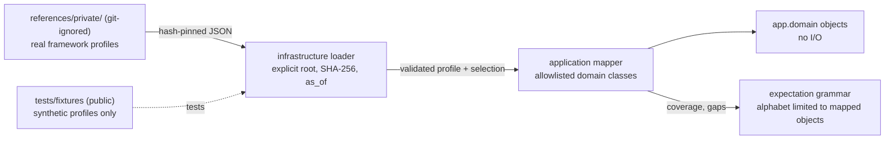

# Framework profiles over domain objects

> [!warning] Status: proposed
> A mechanism for mapping external frameworks onto domain objects, worked through a **synthetic standard**. The real frameworks, their editions, which domain each one serves and every real mapping are private reference data, held server-side and never in this repository. Nothing here claims conformity with any standard.

## Why profiles

Each domain could carry its own vocabulary, which multiplies reference surface. Instead, a small number of framework profiles is mapped onto domain objects: one profile per framework, not one per domain. A domain is reached either natively (the framework was written for it) or by mapping (a framework written for another domain reaches it). Where no mapped framework reaches far enough, a dedicated **gap framework** fills only that named gap.

## Roles and coverage

| Term | Meaning |
| --- | --- |
| primary | the one framework a domain is read through; every domain has exactly one |
| secondary | an extra framework used only where a profile lists it |
| gap | a framework that fills one named gap and nothing else; it never replaces the primary |
| `native` | the framework's concepts were written for this domain |
| `mapped` | concepts from a framework for another domain reach this domain fully |
| `mapped, partial` | they reach it with a recorded gap |
| `mapped, gap filled` | the recorded gap is filled by a gap framework |

A coverage label says how far a framework's concepts reach a domain. It is not a measure of how well the system implements the framework.

## The synthetic standard

Two synthetic frameworks stand in for real ones. Their concepts are invented for this example. Fixture: [`tests/fixtures/framework_profiles/synthetic_profiles.json`](../../tests/fixtures/framework_profiles/synthetic_profiles.json).

| Framework | Kind | Concepts |
| --- | --- | --- |
| `SYN-A` | primary framework | work container, record, part of a whole, catalog item, list of parts |
| `SYN-G` | gap framework | maturity class |

| Concept | Domain | Domain object | Role | Coverage |
| --- | --- | --- | --- | --- |
| `SYN-A.C1` work container | Projects | `Project` | primary | `native` |
| `SYN-A.C2` record | Working Docs | `Document` | primary | `mapped` |
| `SYN-A.C3` part of a whole | Subsystems | `Subsystem` | primary | `mapped` |
| `SYN-A.C4` catalog item | Inventory | `ProductDefinition` | primary | `mapped, partial` (gap: movement events) |
| `SYN-A.C5` list of parts | Inventory | `BOM` | secondary | `mapped, partial` |
| `SYN-G.C1` maturity class | Estimation / Needs Analysis | none yet | gap | `mapped, gap filled` |

What the example shows:

- One framework reaches several domains by mapping, so the profile count stays below the domain count.
- A partial mapping records its gap in words; it does not invent a domain object to close it.
- A gap framework may name a domain with no domain object yet. It then maps to nothing and lets the grammar grow nothing; it only records that the gap is covered once objects exist.

## Profile shape

| Field | Rule |
| --- | --- |
| `schema` | `framework-profile/0`; a dedicated schema, separate from the enterprise reference dictionary and the path-rule projection |
| `framework_id`, `framework_edition` | opaque in public fixtures; real identifiers and editions are private |
| `kind` | `primary` or `gap` |
| `profile_version` | version of this mapping, not of the framework |
| `source_digest` | SHA-256 of the private source the mapping was built from |
| `valid_from`, `valid_to` | timezone-aware validity window |
| `concepts[]` | `concept_id`, `label`, `domain`, `maps_to` (an allowlisted domain class or `null`), `role`, `coverage`, optional `gap` |

## Infrastructure

| Concern | Placement | Rule |
| --- | --- | --- |
| Real profiles | `references/private/`, git-ignored, server-side | framework names, editions, mappings and clause references never enter the public tree |
| Public profiles | `tests/fixtures/` | synthetic only, opaque identifiers |
| Loading | infrastructure, following the hash-pinned pattern in `app.infrastructure.enterprise.references` with its own schema | explicit absolute root, path inside root, size limit, SHA-256 match, closed JSON, `as_of` inside the validity window |
| Mapping | application | `maps_to` must be an allowlisted domain class; no class name in a profile is imported or executed |
| Domain | `app.domain` | Pydantic only, no file access |
| Grammar | expectation grammar | grows symbols only for concepts that map to a domain object |

## Substitute ranking (generic)

A framework that models commercial exchanges can rank substitute products inside an estimate. The caveats hold for any such framework:

1. A substitute ranks only if its configuration is valid under one pinned feature-model revision.
2. Model-valid is not compatible; interface compatibility needs its own typed evidence, otherwise `unknown`.
3. Model-valid, ordered, observed installed and test-passed stay separate statuses.
4. Only configurations with source evidence rank; "not observed" is not "absent".
5. Adoption lag runs from first evidenced availability to first verified adoption; a precedent is not a transfer.
6. Sell price, cost and actuals stay distinct.
7. A rank is a candidate list; a gate decides.
8. A rank cannot claim more maturity than its estimate's maturity class supports.
9. Opaque identities only.

## Acceptance

[`tests/test_framework_profiles.py`](../../tests/test_framework_profiles.py) checks the synthetic fixture:

1. Every concept's `maps_to` is `null` or a class in the domain scaffold manifest.
2. Roles and coverage labels come only from the tables above.
3. Each domain in a primary profile has exactly one primary concept framework.
4. Gap concepts appear only in `gap` profiles and carry `coverage: mapped, gap filled`.
5. Every `mapped, partial` primary concept names its gap.
6. Validity windows are timezone-aware.

## Decisions needed

1. Timecards: two clocks (when work happened, when it was recorded, corrections appended) or reference validity windows only.
2. Substitute ranking criteria and weights.

## Not claimed

- No real framework profile, loader change or mapper exists in this repository.
- The synthetic frameworks resemble no particular standard.
- See [L-system domain vocabulary](LSYS_DOMAIN_VOCABULARY.md) for the grammar alphabet these mappings constrain.
