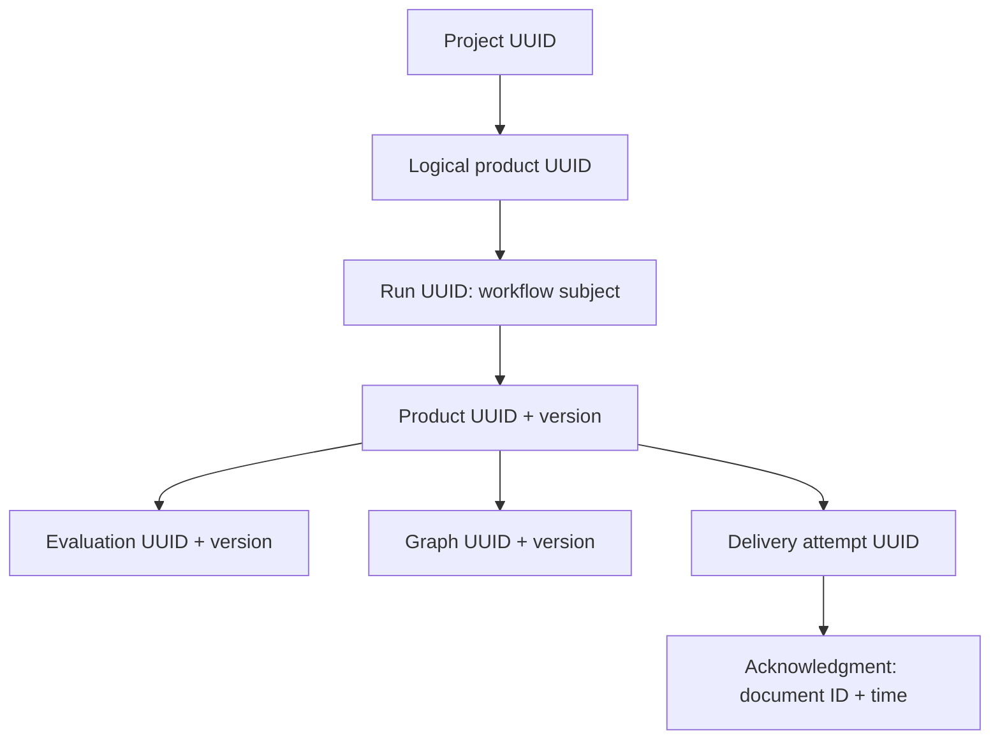

# P4 first change: design and contract baseline

Status: **proposed technical contracts; no P4 runtime, approval grant or production publication**. Starting public `main`: `3a375d2f3ae24ec39ffcd12a6a849c2d8d23d599` (2026-11-19). The superseding P4 Developer Instructions supplied by James govern this page. The executable application DTOs are in `app.application.p4.contracts`; they do not implement the 17 deferred P4 domain classes.

## Provenance of decisions

- **James requirement:** Workflow I runs are workflow subjects; refresh creates a new run; five public states; automatic publication after integrity checks; Published only after destination acknowledgment; warnings for honestly represented gaps; collision and double counting block; previous successfully published version is the delta baseline; no private Acumatica or part references in the public repository.
- **Developer encoding:** UUID identities, per-aggregate monotone versions, pinned run inputs, SHA-256 over canonicalized request parameters, same-transaction process/transition/decision references, explicit gate result vocabulary, and allowlisted ingress DTOs. These are reviewable proposals, not existing production policy.
- **Synthetic only:** `workflow-i-synthetic-publication/v1`, `workflow-i-synthetic-calendar/v1`, a synthetic source and destination with opaque IDs. It does not confer KCM accounting or operational authority.
- **Unresolved production configuration:** destination/document operation and location, actual ClickUp completion semantics, approved source-safe labels, actual reporting cutoff, real adapter capabilities, accounting mappings, authorization grants/access control, and accepted live measure definitions. No live run is enabled by these contracts.

## Canonical reuse map and dependencies

| Area | Current canonical component | Status and use in this change |
| --- | --- | --- |
| Identity and capture | `app.domain.shared.identity`, `facts`, `quality_evidence`, `versioning` | Accepted V1 proposal: opaque IDs, explicit fact status, evidence and immutable capture. Retain historical limitations and independent reference verification. |
| Process | `app.application.process.contracts.ProcessExecution`, `ObjectIncidence`, `CapabilityBinding`, `AuthorityRef`; `lifecycle.derive_object_events` | Accepted process vocabulary; execution is authoritative provenance. Existing `decision=hold/release/reject/return` is an effect, not a Workflow I lifecycle state or an authorization grant by itself. |
| Persistence | `app.application.persistence` VersionedRecord, CommandRecord, UoW and outbox | Existing technical mechanisms; adapt for atomic P4 workflow commits, version checks, durable checkpoint and request fingerprint. Existing CommandRecord lacks fingerprint; add a compatible application wrapper or stored request payload, not a competing command log. |
| Messaging | `app.application.messaging` EventEnvelope and outbox | Reuse after transaction commit; replay never emits effects. |
| HTTP | `app.interfaces.http` app/container/wiring | Existing FastAPI composition; add P4 routes/adapter injection later. No synthetic fallback for an unconfigured live adapter. |
| P4 domain | 17 `app.domain.workflow`, `quality`, `project.milestone` classes | Unreviewed scaffolds requiring implementation in the next change; this first change does not mark traceability implemented. |
| Cross phase | `app.domain.data_governance.data_product`, `data_lineage`, `commercial.cost_code` | Unreviewed scaffolds; minimum reviewed dependencies to follow. Do not assert every later-phase concept is complete. |
| Commercial | `app.domain.commercial.commercial_order.Order`, `Contract`, `materials.bom_line` | Reuse `Order`; a source line has no implicit BOM identity. A `Contract` is company–client; subcontracts belong to other stakeholders. No NLP extraction here. |
| Contracts and generators | `scripts/gen_agency_contract_docs.py`, `gen_openapi.py`, `gen_domain_scaffold_docs.py`; `tests/test_domain_scaffold.py` | New P4 DTOs are handwritten and tested here. Generator registration and emitted schemas/OpenAPI follow when P4 domain and HTTP surface are implemented; do not hand edit generated files. |
| Private integrations | Acumatica OData adapter, mappings and part-number crosswalk | Deferred, outside public repo. Outbound ClickUp adapter also deferred; public tests use synthetic destination only. |

Dependencies: P4 domain decisions → source/destination ports → UoW persistence → measures/graphs → delivery acknowledgment → HTTP. Preserve V1 fact/evidence/authority limitations; no migration or production policy is implicitly approved. `docs/ROADMAP.md` is historically stale; the superseding brief governs P4.

## Identity and version topology

A project owns logical product identity for a configured output profile, not a source business number. A retry retains run ID and request key; a refresh gets a fresh request key/run and a new immutable product version. Historical reproduction pins an extraction manifest and creates a new run but does not automatically republish. A HIL label creates a new label event, evaluation and affected product/graph versions; no previous product or decision is edited. Delivery attempt identity is independent of product identity; retries reconcile an existing attempt before creating another document. `latest_run` and `latest_published_version` are distinct references. `VersionRef` identifies immutable published/prepared payloads; projection materialization may advance without modifying them.

## Request fingerprint and reporting time

`GenerationRequest.fingerprint` hashes sorted, compact ASCII JSON with schema version, project/product UUIDs, mode, UTC microsecond window bounds, calendar ID/version, output/source profile, mapping/calculation/policy versions and optional pinned manifest digest. UUIDs use canonical lowercase hyphenated form; JSON field names use stable Pydantic serialization. `request_key` is excluded from the digest and retained in the existing command record. Same key + same digest returns the original run; same key + different digest is a conflict and performs no extraction/delivery. Different key with identical content is a deliberate new run (including refresh). Runtime-added IDs, display formatting, trace IDs and request receipt time are not behavioral inputs. Changes to any behavioral setting require a new calendar/profile/policy version and therefore a new fingerprint. Hash version and canonicalization cannot change silently.

`ReportCalendar` configures IANA timezone, calendar version and a **local exclusive cutoff**. Source occurrence, modification, receipt, processing, preparation and delivery acknowledgment are separate time fields; the synthetic example uses `America/Los_Angeles`, cutoff `06:00` local and 9:00 AM local as a **marked fallback for a known source date without time**. Preserve `original_date` and `date_precision`. An unknown source date remains unknown. A UTC instant always accompanies a timezone/precision interpretation; a date-only Excel cell is not an invented timestamp. Calendar windows are half-open `[start, cutoff)` with timezone-aware instants. Each SO/PO date retains its supplied operational meaning: order, posting, fulfillment or receipt dates are not substituted for one another. Inclusion rules come from versioned measure definitions, not the 9:00 fallback. Ambiguous/nonexistent local cutoffs require explicit resolution when configuring a real calendar; the synthetic fixtures use unambiguous dates.

## Synthetic measure catalog (`workflow-i-synthetic-measures/v1`)

| Measure | Unit and grain | Include | Duplicate / exclusion | Provenance and unavailable condition |
| --- | --- | --- | --- | --- |
| SO line sell | Source currency, SO line | Explicit evidenced amount for a confirmed project line, at its source date meaning | Exact same source ID+version counted once; changed value with same source ID is ambiguity until reconciled; candidates stay outside confirmed totals | Keep source line/version, evidence, date meaning; unavailable if no source amount/currency, unsupported coverage or no confirmed association. |
| PO line ordered | Source currency, PO line | Evidenced ordered amount for confirmed PO line | Same duplicate rule; do not merge with SO value or count as incurred cost | Keep PO source/version, currency and date meaning; unavailable if amount/currency/order link is unsupported. |
| Recorded labor hours | Hours, time entry | Evidenced time entry with confirmed project and hours | Same duplicate rule; no conversion from sold lump-sum amount | Keep source entry/version, period, classification and evidence; unavailable if hours or project assignment is unknown. |
| Compatible category total | Identical unit, currency, category, project | Sum source-compatible confirmed observations only | Reject unit/currency collisions or unresolved double counting; never allocate ambiguous amounts | Retain each input and rule version; unavailable if there is no compatible evidenced input. |

Categories remain hourly internal labor, lump-sum internal labor, products, outsourced labor and integration materials. Preserve original classification separately from proposed classification and version effective-dated mappings with explicit exceptions. Skill does not select a labor code. Unposted, provisional, late and corrected entries are marked, not silently discarded. Actual incurred cost, margin, earned value and budget variance are unavailable without separately supplied sources and rules. Do not combine unlike currencies or measures; multiple currencies may coexist in distinct labeled series.

## Commercial association and candidate rules

| Basis | Evidence | Effect on confirmed totals |
| --- | --- | --- |
| Explicit source link | Existing source-record version, exact typed endpoints and independent evidence reference | Eligible after link and project membership validation. |
| Reviewed mapping | Versioned mapping rule, effective interval, source record and evidence | Eligible only in scope and time; mapping alone is not financial approval. |
| HIL-confirmed | Recorded label event, actor and targeted candidate/evidence versions | Eligible only after a new evaluation/product version confirms applicability; never rewrite earlier totals. |
| Unresolved candidate | Supporting/conflicting evidence, method version and candidate IDs | Display in Symballion queue and Void gaps; not a confirmed allocation. |

Conflicting evidence prevents confirmation until resolved. An SO/PO line is not a BOMLine; neither a contract nor a subcontract is inferred from a numerical code. A confirmation label does not grant gate approval or authority to alter the source accounting allocation.

## Gate truth table and transition policy

`CriterionAssessment` validates the local result; cross-record tests check exact evidence and target versions. `sufficient` means the criterion's declared predicate passes on applicable, current evidence; `fails` means it does not. Applicability may itself be unknown.

| Requirement | Applicability | Evidence | Result | Transition |
| --- | --- | --- | --- | --- |
| Mandatory or conditional | Yes | Sufficient | Pass | Eligible for a separate decision/policy. |
| Mandatory or conditional | Yes | Fails | Fail | Block. |
| Mandatory or conditional | Yes | Missing / conflicting / stale | Missing / conflicting / stale | Block. |
| Conditional | Unknown | Any | Missing | Block; never infer not applicable. |
| Conditional | No | Any | Not applicable | Eligible; record why inapplicable. |
| Mandatory | No | Any | Invalid definition | Reject the criterion definition. |
| Mandatory | Unknown | Any | Missing | Block until applicability is known. |
| Informational | Yes | Any | Corresponding result | Warn, never independently block. |
| Informational | No/unknown | Any | Not applicable/missing | Record gap; never independently block. |

A mandatory rule with `applicability=no` is invalid even at the generic DTO boundary. A gate evaluation can complete with blocked criteria. GateDecision records actor, bounded authority, scope, purpose and exact evidence/target versions; passing evaluation is not an approval. Generic approvals must not silently carry to a new target/scope. Workflow I's synthetic publication policy performs integrity checks automatically; no manual approval is required for that particular transition. Public `Failure` is an execution state, not a gate outcome.

### Synthetic publication policy (`workflow-i-synthetic-publication/v1`)

After immutable Prepared output, publish automatically only if source and lineage versions reconcile, output passes private-data checks, no mixed-unit/currency aggregate or unresolved duplicate is represented as confirmed, and an approved synthetic destination profile is configured. Missing WBS, provisional entries or uncertain attribution may publish with labeled warnings, candidate queue and explicit coverage. Unresolved associations do not enter confirmed totals. The automatic decision/evaluation is recorded with its policy version, not represented as a KCM human authority grant. The `Published` transition occurs **only after verified destination acknowledgment** for all configured required outputs. Timeouts, rejection and lost acknowledgment preserve attempt history; retry reconciles destination identity before any create. A queue acknowledgment is insufficient without destination verification. Production ClickUp operation and authorization remain unconfigured.

## Process history, atomicity and replay

One applied `StateTransition` references exactly one **committed** `ProcessExecution` and the run's expected/committed versions. For controlled changes it also references the relevant `GateDecision`, which references the same execution, exact evaluation and applicable authority or named automatic policy. A process decision (`release`, `hold`, etc.) remains a control effect; it is never a Workflow I public state. Every gate approval is scoped to its target version, transition and purpose. `AppliedTransition` is an indexed projection/reference, not a second source of independently writable history.

Command handler algorithm for later implementation: lock run with the existing UoW/CAS; verify previous version and sequence; persist process execution, decision, transition reference, next run aggregate and outbox event in **one transaction**; commit; then publish outbox. A rejection leaves no partially applied transition. Reader reconstructs from committed executions and indexed links; compare sequence, execution uniqueness, state/version adjacency and decision/evidence link integrity to stored run state. A mismatch is corruption, blocks further transitions and requires investigation. Replay is read-only: never re-run adapter, publication or outbox effects. A prepared product's exact source/mapping/policy digests and output references belong in a durable stage checkpoint before delivery. Retries never overwrite committed history.

Valid synthetic edges: Requested→In Process/Failure; In Process→Prepared/Failure; Prepared→Published/Failure; Failure→In Process only after a new auditable attempt. Published is terminal for that run. No automatic review on every revision; explicit policy evaluates whether the prior decision still applies to its target/version. Correction records keep suspicion, investigation, action, independent verification if configured, closure, reopening and evidence history distinct. Planned milestone date, evidenced milestone occurrence and milestone sign-off are separate records.

## Ingress, outward validation and resume

**`PublicSourceSanitizer`** is the named composition component at the private adapter → public core boundary. It resolves source keys and actual part numbers against private server-readable references, emits opaque UUIDs and the `PublicSourceRecord` allowlist, and rejects unexpected keys including arbitrary free text. The public DTO cannot accept raw part numbers or descriptions. The same allowlist is revalidated before persistent store and outward API, graph, event, trace, log, export, fixture and generated-doc surfaces; safe logging uses IDs and error codes, not failed lookup values. This is defense in depth, not proof that arbitrary secrets can never leak. Synthetic sentinel tests target these surfaces as each is implemented. Private reference tables/adapter modules are excluded from public packaging.

`ExtractionManifest` records versioned capability (`stable_snapshot`, `change_token`, `best_effort`), extraction ID, source contract/profile, token if available, page count/completeness, digest, window/cutoff, receipt time and limitations. A checkpoint additionally pins mapping/calculation/policy versions and intermediate-output digest. On resume, reuse complete byte-equivalent extraction only; changed token triggers full refetch and recomputation; changed profile/window, partial pages or changed capability block assembly. A best-effort source can only reuse the exact pinned extraction, never assemble pages from another fetch. A consistency limitation can publish as a warning only if a versioned policy can still faithfully describe the covered population; misleading deltas/removals block. Incomplete extract absence never proves deletion. Real adapter conformance must exercise these same cases without live payload publication.

## Daily deltas and delivery boundary

Delta base = previous **successfully acknowledged** product version, not preceding run. First publication is a baseline, not a claim all historical changes happened today. Missed runs widen the actual comparison interval. Track source event time and first observed time, so backdated entries are identified as newly observed historical entries. A partial extract cannot imply removal. Publish order uses version/CAS so a concurrent older run cannot move the baseline backward. The destination port must support delivery identity, returned document ID, status verification and safe retry/reconciliation. Both latest attempted run and latest published version remain visible.

## Decision register

| Decision | Proposal / consequence | Status |
| --- | --- | --- |
| History ownership, identity, fingerprint, gate truth table, sanitizer, resume | Technical encodings above and in executable contracts. | Proposed for review; does not change business evidence or grant authority. |
| Actual-cost calculation or lump-sum conversion | No synthetic value: showing a computed cost without a verified source would mislead PMs. | Requires James/accounting decision and private mapping before production. |
| HIL candidate for a $1,000 PO line with two plausible projects | Show $1,000 as unallocated candidate and exclude from each confirmed project total; resolving creates a new version. | James requirement: no silent confirmed allocation; production evidence standard remains to be confirmed. |
| Production ClickUp destination and acknowledgment | Synthetic destination acknowledges; no location/operation is invented. `Published` must await verified receipt. | Production configuration/acceptance pending. |
| Reporting calendar and publication authority | Synthetic `06:00 America/Los_Angeles`, automatic named synthetic policy only; changing KCM cutoff or operating authorization changes PM experience and authority. | Production configuration/approval pending. |

## Next change and limits

Implement/review each of the 17 domain scaffolds, integrate their cross-record invariants and history with UoW, source/destination conformance, checkpoint and orchestration. Then register generated schemas/OpenAPI with the existing generators, update P4 traceability based on executable evidence and run the full test suite. This document and its focused tests establish a proposed foundation; they do **not** claim orchestration, HTTP delivery, automatic publication or P4 completion.
