# Process-first domain

> [!note] Status
> Implemented in `app.application.process` (Pydantic only). Generic vocabulary: process codes, stage codes and roles are supplied by the caller. Company-specific catalogues and mappings stay outside the public tree.

## The rule

**Nothing happens without a process.** A resource alone does nothing; an object alone sits still. Every record starts from a `ProcessExecution`:

```text
ProcessExecution(stage)
  incidence    objects it produces, consumes, reads, revises, holds, checks or transfers
  executed_by  capability bindings: which resource did it, with what evidence
  decision     hold / release / reject / return    (control processes only)
  authority    who may decide, and the evidence of that right
```

- **Objects are things, never people.** Documents, equipment, orders, configurations, punch items.
- **Resources execute.** People, teams, tools and subcontractors appear only inside a `CapabilityBinding`.
- **Gates are control processes.** A gate is a control-class execution whose output is a decision plus verification evidence.

```mermaid
flowchart LR
  PT["ProcessType<br/>code, name, function classes"] --> PX["ProcessExecution<br/>stage, subsystem, time"]
  PX --> OI["ObjectIncidence<br/>object, effect, state before/after"]
  PX --> CB["CapabilityBinding<br/>resource, role, evidence"]
  PX --> AU["AuthorityRef<br/>role, scope, evidence"]
  PX -->|"derive"| OE["ObjectEvent<br/>birth, death, state change"]
  PX -->|"project"| PE["ParticipationEdge<br/>for the gauge null"]
```



## Function classes

| Class | Changes | Allowed effects |
| --- | --- | --- |
| `transform` | object form or content | produces, consumes, reads, revises |
| `transport` | object location, not form | reads, transfers |
| `hold` | nothing but time: buffers objects | reads, holds |
| `exchange` | custody or value across an organisational boundary | produces, consumes, reads, transfers |
| `control` | a decision about other work | reads, checks |

An execution may carry several classes (for example transform + control for a bench test). Each effect must be allowed by at least one of its classes. `ProcessType.approved` stays `False` until a process SME signs off the classification; inferred classes are not facts.

## Object lifecycle

Births and deaths happen **only at processes**:

| Effect | Lifecycle event | Rule |
| --- | --- | --- |
| `produces` | **birth** | object must not already be alive; `state_after` required |
| `consumes` | **death** | object must be alive; no `state_after` |
| `revises`, `transfers`, `holds` | state change | object must be alive; `state_after` required |
| `checks` | state change only if the gate decides | `state_after` allowed only with a decision |
| `reads` | none | object must be alive |

Release, return and transfer are **state changes, not deaths**. An object that is never consumed stays alive at the end of the window: its lifetime is censored, not closed.

`derive_object_events(executions, preexisting=...)` replays executions in the order given and raises `LifecycleError` on a death before birth, a double birth, a double death, or any use of a dead object. The caller orders executions; same-day ties are the caller's problem to declare, not this function's to guess.

## Buffers (0.9.9, optional)

Where things happen, for the [HFGT capability graph](../pipelines/HFGT_CAPABILITY_GRAPH.md):

| Field | On | Rule |
| --- | --- | --- |
| `at_buffer` | `ProcessExecution` | where a transform, control or hold happens |
| `origin_buffer`, `destination_buffer` | `ObjectIncidence` | `transfers` only, set together or not at all |

All optional: 0.9.8 payloads validate unchanged, and ingestion projections are byte-identical. A missing buffer is
not a validation error; the HFGT translation reports it as a gap.

## Gate rules (validators)

1. `decision` requires the `control` class.
2. `decision="release"` requires an `AuthorityRef` with scope `release`, at least one `verification_evidence` object, and `epistemic_status="computed"`. **Simulated work never releases.**
3. Every verification evidence id must be an object the execution `reads` or `checks`.
4. A resource id can never appear as an object id.
5. One incidence per object per execution.

Entering a gate is not approval: an execution that `checks` an object without a decision changes nothing.

## Participation projection

`ProcessExecution.participation()` returns one `ParticipationEdge(resource_id, process_id=execution_id, stage)` per capability binding. The stage-preserving participation null in the gauge slice consumes these. They are **derived**, never authored directly.

## Example (doctest)

>>> import sys; sys.path.insert(0, "src")
>>> from app.application.process import (AuthorityRef, CapabilityBinding, ObjectIncidence, ProcessExecution,
...                                      ProcessType, derive_object_events)
>>> design = ProcessType(code="design", name="Design package", function_classes=("transform",))
>>> review = ProcessType(code="review", name="Design review", function_classes=("control",))
>>> made = ProcessExecution(execution_id="demo:design:1", process=design, stage="S2",
...     incidence=(ObjectIncidence(object_id="obj-drawing", effect="produces", state_after="draft"),),
...     executed_by=(CapabilityBinding(resource_id="res-designer", resource_role="designer"),))
>>> gate = ProcessExecution(execution_id="demo:review:1", process=review, stage="S2",
...     incidence=(ObjectIncidence(object_id="obj-drawing", effect="checks", state_before="draft", state_after="released"),
...                ObjectIncidence(object_id="obj-checklist", effect="reads")),
...     executed_by=(CapabilityBinding(resource_id="res-reviewer", resource_role="reviewer"),),
...     decision="release", verification_evidence=("obj-checklist",),
...     authority=AuthorityRef(holder_role="design-approver", scope="release"))
>>> [(e.kind, e.object_id, e.state) for e in derive_object_events((made, gate), preexisting=("obj-checklist",))]
[('birth', 'obj-drawing', 'draft'), ('state_change', 'obj-drawing', 'released')]
>>> [(p.resource_id, p.process_id, p.stage) for p in made.participation()]
[('res-designer', 'demo:design:1', 'S2')]
>>> try:
...     ProcessExecution(execution_id="demo:review:2", process=review, stage="S2", decision="release",
...         incidence=(ObjectIncidence(object_id="obj-drawing", effect="checks"),), executed_by=())
... except ValueError as e:
...     print("rejected:", "authority" in str(e))
rejected: True

## Not claimed

No process catalogue ships. Function classes, stage vocabularies and object kinds are the caller's, and remain unvalidated until a process SME approves them. Event history (real timestamps and ordering) is still required before any process claim.
