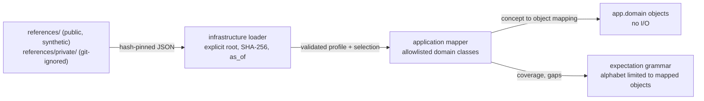

# Seven frameworks over eleven domains

> [!warning] Status: proposed
> A mapping proposal for infrastructure and vocabulary. It claims no conformity, compliance or certification against any standard, and it adds no domain classes. Coverage labels describe how far a framework's concepts reach a domain, not how well the system implements the standard.

## Why seven, not eleven

The soil-science lens (USDA pedon, profile, horizon, formation processes) was rated a design aid, not a schema, and was ruled out for Drawings. Each domain was then given a purpose-built framework. Seven frameworks are enough: four domains are reached by mapping onto frameworks that already serve another domain. One profile per framework, not one per domain, keeps the reference surface at seven.

Soil-derived analogies stay a separate, unresolved lens. They are not domain classes and are not encoded here.

## The seven frameworks

| ID | Framework | Mathematical lens | Native domain |
| --- | --- | --- | --- |
| F1 | ISO 21502 project management, with ISO 21511 work breakdown | lifecycle states and hierarchical decomposition | Projects |
| F2 | ISO 15489-1 records, ISO 23081 metadata, W3C PROV-O | provenance graph of entity, activity and agent with derivation edges | Working Docs |
| F3 | ISO/IEC 15944-4 business transaction ontology, OASIS UBL | transaction state machine over resources, events and agents | Commercial Orders |
| F4 | ISO/IEC/IEEE 42010 architecture description | typed graph of concerns, viewpoints, views and correspondences | Subsystems |
| F5 | IEC 62381 FAT/FIT/SAT/SIT | test basis and conditions, expected versus observed result, criterion | Site Acceptance Testing |
| F6 | ISO/IEC 26580 feature-based product-line engineering (ISO/IEC DIS 26581 for time, draft only) | feature model; a configuration is valid when it satisfies the model's constraints | Product Features |
| F7 | GS1 EPCIS and CBV | typed visibility events: what, when, where, why | Inventory |

Editions are pinned in each framework profile, not here. No standard text is reproduced; profiles carry concept names and clause references only.

## Eleven domains on seven frameworks

| Domain | Primary | Secondary | Domain objects | Coverage | Gap left by the seven |
| --- | --- | --- | --- | --- | --- |
| Projects | F1 | | `Project`, `Phase`, `WBS`, `Task` | native | none recorded |
| Inventory | F7 | F3 (custody and exchange) | `ProductDefinition`, `AssetInstance`, `BOM`, `BOMLine`, `Shipment`, `ShipmentLine` | native | stock ledger and reservation policy |
| Employees and Contributors | F1 (roles, responsibilities, delegated authority) | F2 (PROV agent, delegation chain) | `Employee`, `Contributor` (resources), `CapabilityAssertion` | mapped, partial | skills levels; people stay resources, never operands |
| Working Docs | F2 | | `Document` | native | none recorded |
| Drawings | F4 (model kinds, views, correspondences) | F2 (revision and derivation lineage) | `Drawing` (scaffold) | mapped, partial | geometric structure and model constraints |
| Subsystems | F4 | | `Subsystem` | native | none recorded |
| Product Features | F6 | | none yet | native | objects pending the 0.11 versioned feature graph |
| Site Acceptance Testing | F5 | F2 (test records as evidence) | none yet | native | test-basis, result and acceptance objects |
| Commercial Orders | F3 | | `Order` | native | `Contract` remains a scaffold |
| Clients | F3 (party and agent roles) | | `Client` on `Party` | mapped | registry-sourced legal identity and parent links |
| Estimation / Needs Analysis | F3 (planning, identification and negotiation phases; pricing) | F6 (configuration validity, for substitutes) | none yet | mapped, partial | estimate class thresholds; see [Estimation and substitute ranking](#estimation-and-substitute-ranking) |
| Timecards (cross-cutting) | F2 (activity start and end, capture) | F3 (time as a consumed resource) | `TimeCard` (scaffold) | mapped | not a domain; recorded-versus-valid time is handled by reference validity windows |

Each domain has exactly one primary framework. A secondary framework is used only where listed. A partial gap is recorded, not filled by an eighth framework, until the coordinator decides otherwise.

## Gap coverage matrix

Fit of each framework to the three partial domains: 3 covers the gap, 2 partial structure, 1 vocabulary hint, 0 none. A judgement from each framework's stated scope, not a clause-level assessment.

| Framework | People: skills and authority | Drawings: model structure and constraints | Estimation: class thresholds |
| --- | --- | --- | --- |
| F1 | **2** (selected) | 0 | 1 |
| F2 | 1 | 1 | 0 |
| F3 | 1 | 0 | **1** (selected) |
| F4 | 1 | **2** (selected) | 0 |
| F5 | 1 | 0 | 1 |
| F6 | 0 | 1 | 0 |
| F7 | 0 | 0 | 0 |

No framework reaches 3 on any gap; the three remain partial.

## Estimation and substitute ranking

F3 gives estimation a transaction frame: planning, identification and negotiation precede any commitment, and pricing belongs to an exchange between parties. That frame lets an estimate rank substitute products, under these caveats from the feature-compatibility research:

1. **Validity is per model revision.** A substitute is ranked only if its configuration satisfies the feature model (F6) under one pinned model revision. A refines / breaks / unknown verdict between revisions is deferred to the 0.11 versioned feature graph.
2. **Model-valid is not compatible.** Feature-model constraints do not prove physical or interface compatibility. Interface compatibility needs its own typed evidence (F4 correspondences); without it the substitute stays `unknown`, never compatible.
3. **Four statuses stay separate:** model-valid, ordered, observed installed, test-passed. Each transition needs its own evidence; a rank moves none of them.
4. **Valid is not observed.** A configuration the model allows may never have been offered. Ranking uses only configurations with source evidence; "not observed" is kept separate from "absent".
5. **Adoption lag is defined, not assumed.** Lag runs from first evidenced availability to first verified adoption by another family; an external precedent is not proof of transfer.
6. **Sell is not cost.** A ranked substitute's price comes from a priced line with lineage; sell price, cost and actuals stay distinct.
7. **A rank is a candidate list.** Ranking proposes; evidence disposes; a gate decides. No substitute is released or ordered by its rank.
8. **Opaque identities only.** Public profiles and outputs never carry actual part numbers or vendor identifiers.

## Infrastructure

| Concern | Placement | Rule |
| --- | --- | --- |
| Framework profile | one JSON reference file per framework, under `references/` | carries `framework_id`, framework edition, `profile_version`, `source_digest`, concept-to-domain-object mappings and coverage labels |
| Loading | infrastructure, reusing the hash-pinned pattern in `app.infrastructure.enterprise.references` | explicit absolute root, path inside root, size limit, SHA-256 match, closed JSON, timezone-aware `as_of` inside the validity window |
| Provenance | the loader's selection record travels with every mapped result | dictionary id, version, file and payload digests, `as_of` |
| Mapping | application | concepts map only into allowlisted domain classes; no class name in a profile is imported or executed |
| Domain | `app.domain` | Pydantic only, no file access, no NumPy or Torch |
| Private mappings | `references/private/`, git-ignored, server-side | enterprise terms, codes and file names never enter public profiles |
| Grammar | expectation grammar | may grow symbols only for domains with mapped objects; gap domains grow nothing |

## Proposed acceptance

1. Every domain resolves to exactly one primary framework, and every framework ID is one of F1 to F7.
2. Coverage labels are limited to `native`, `mapped`, `mapped, partial`.
3. A profile whose SHA-256 or payload digest differs from the pinned value is rejected.
4. A profile naming a class outside the allowlist is rejected.
5. Domains without domain objects produce no grammar symbols.
6. Public profiles contain no private terms (checked by `dmgov release --terms`).

## Decisions needed

1. Whether framework profiles reuse the existing reference dictionary schema or get their own schema. The existing dictionary and the path-rule projection already keep distinct schemas and digest semantics; a third schema needs the same separation.
2. Whether Drawings (geometric model structure) and Estimation (class thresholds) stay recorded gaps or justify dedicated frameworks.
3. Whether Timecards' valid-versus-recorded time needs more than reference validity windows.
4. The ranking criteria and weights for substitutes (none are set here).

## Coordinator decisions (2026-11-21)

1. Employees and Contributors: F1 primary.
2. Drawings: F4 primary.
3. Estimation / Needs Analysis: F3 primary, with the substitute-ranking caveats above.

## Not claimed

- No framework profile, loader change or mapper exists yet.
- A coverage label is not conformity to the standard.
- No substitute-ranking algorithm, criteria or weights exist.
- Mappings onto a secondary framework are interpretations for vocabulary, not equivalences.
- See [L-system domain vocabulary](LSYS_DOMAIN_VOCABULARY.md) for the grammar alphabet these mappings constrain.
