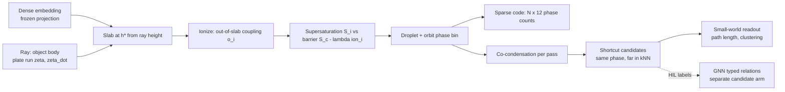

# Embedding enrichment: supersaturated cloud, ionizing rays, sparse condensation

> [!warning] Defined rules, not physics of the records
> Ionization, supersaturation and condensation are rules **defined here** on a frozen projection. Every output is `simulated`. A shortcut is a **candidate** relation for human labeling, never a relation: retrieval confidence is not relation confidence.

## Purpose

A dense embedding is a smooth field: following its tensor gradients only ever reaches neighbours. Enrichment adds a **sparse code** that can link records the dense geometry keeps apart, so a small-world map of **shortcuts** can sit on top of the gradient field.

- The cloud is **supersaturated**: every record sits just below a condensation threshold.
- A **ray** sweeps through it: the object body of a [plate run](PLATE_ISOSCELES.md) rides the plate normal, and its height selects a thin **slab** of records at the matching off-plane height.
- Records in the slab whose neighbours lie just outside it are **ionized** (activation); ions lower the local barrier.
- Where supersaturation crosses the (lowered) barrier, a **droplet condenses** on the record.
- Droplets record the **orbit phase** of the ray. Each record's nucleation counts per phase bin form its **sparse embedding**.
- Records that condense together in the same phase across several passes, yet are far apart in the dense kNN graph, become **shortcut candidates**.

## Rules (per update, per arm)

Off-plane height of record $i$: $h_i = (x_i - o)\cdot n$ for the request's slab frame (origin $o$, unit normal $n$). Scale $h_q$ = 95th percentile of $|h_i|$. With the ray at height $Z$ and rate $\dot Z$ (from the plate run's `zeta`, `zeta_dot`), $Z_{wall} = \max|Z|$, $\dot Z_{ref} = \max|\dot Z|$:

| Quantity | Rule |
| --- | --- |
| slab | records with $|h_i - h^*| \le w$, where $h^* = Z\,h_q / Z_{wall}$ and $w = w_f h_q$ |
| out-of-slab coupling | $o_i$ = share of $i$'s kNN weight from neighbours with $w < |h_j - h^*| \le w + r_f h_q$ |
| ionization | $ion_i \leftarrow ion_i e^{-\Delta t/\tau_{ion}} + \alpha\, o_i \Delta t$ in the slab, **activation arms only** |
| supersaturation | $S_i = S_0 + \varepsilon \min(1, |\dot Z|/\dot Z_{ref}) + \kappa\, o_i$ |
| condensation | droplet when $S_i \ge S_c - \lambda\, ion_i$ and no live droplet; **ion-free** if $S_i \ge S_c$ |
| evaporation | droplet size $\times e^{-\Delta t/\tau_{drop}}$, removed below 0.05 |
| post-condensation $P$ | gain $\times \sum$ droplet size $\times$ kNN weight to neighbours in the reach band |
| orbit phase | $\theta = \operatorname{atan2}(-\dot Z/\dot Z_{ref},\ Z/Z_{wall}) \in [0, 2\pi)$, 12 bins of 30° |

kNN weights: $k$ nearest neighbours, weight $e^{-d/d_0}$ with $d_0$ the median neighbour distance.

## Passes and order classes

A pass closes at each **splice** of the ray: rising crossing, falling crossing, top apex, bottom apex. Each closed pass is classified:

| Order | Meaning | Anomalous |
| --- | --- | --- |
| `cond-off` | condensed in an activation-off arm | yes |
| `cond-noact` | condensed, activation never reached $I^*$ | yes |
| `cond-first` | condensed before activation | yes |
| `act-first` | activation, then condensation | no |
| `act-only` | activation, no condensation | no |
| `quiet` | neither | no |

## Four arms in lockstep

All arms see **identical** ray motion: `{real, null} x {activation on, off}`. Two nulls, chosen by `null_mode`:

- `axis_shuffle` (default, chamber parity): each embedding axis permuted independently with the request salt. Same marginals, joint structure destroyed, kNN rebuilt.
- `height_preserving`: every record keeps its exact slab height $h_i$ and receives another record's in-plane position. Slab timing is identical to the real arm, so this null asks whether a shortcut is **more than same-height coincidence**.

Shortcut and anomaly counts in the real arms are read **against the null arms**, never alone (`shortcut_excess_on`, `shortcut_excess_off`).

## Sparse embedding

`sparse_code[arm, i, b]` = nucleations of record $i$ in phase bin $b$. Most entries are zero. Dominant phase of $i$: its most frequent bin, with concentration $R_i$ = that bin's share of its nucleations.

## Shortcut candidates

A pair $(i, j)$ is a candidate when both have at least `min_nucleations`, both have $R \ge$ `min_concentration` in the **same** dominant bin, they co-condensed in at least `min_co_passes` passes, and the dense geometry keeps them apart: **different clusters** (if labels are supplied) or at least `min_hops` kNN hops. Score = co-passes $\times \min(\text{hops}, 12)$.

`min_hops` is the gradient criterion: a pair within a few hops is reachable by following the dense field, so it is not a shortcut.

## Small-world readout

On the undirected kNN graph, per arm: clustering coefficient $C$, **global efficiency** $E = \langle 1/d_{ij} \rangle$ (0 for unreachable pairs), mean shortest path $L$ over reachable pairs, and the unreachable fraction, all from up to 256 seeded BFS sources. Then the same with the arm's candidate shortcuts added.

> [!warning] Read efficiency, not path length
> Shortcuts often join components that were disconnected. Then $L$ can **rise** (new long paths enter the average) while the graph became better connected. $E$ handles disconnection; $L$ is reported only next to reachability.

A small-world map has $E$ rising while $C$ stays high. **This describes the candidate map; it does not validate it.**

## Contracts

| Contract | Role |
| --- | --- |
| `SlabFrame` | origin and normal in embedding coordinates (frozen, caller supplied) |
| `ChamberParams` | $S_0, \varepsilon, \kappa, S_c, \lambda, \alpha, \tau_{ion}, \tau_{drop}, I^*, w_f, r_f$, gain, $k$ |
| `ShortcutCriteria` | min nucleations, concentration, co-passes, hops |
| `EnrichmentRequest` | embeddings ref, ids, optional real/null cluster labels, slab frame, the plate run that drives the ray, salt |
| `EnrichmentResult` | sparse code and nucleation tensors, pass records, shortcut candidates, small-world stats per arm |

Port: `EmbeddingEnrichmentPort`. Service: `EnrichmentService`. Arrays live only in `app.infrastructure.enrichment`.

## Acceptance tests

1. Activation-off arms never deposit ions: every droplet there is ion-free and no pass is `act-first`.
2. All four arms close the same number of passes (lockstep).
3. The shuffle preserves each axis's marginal distribution exactly.
4. Above-threshold barrier with $\kappa = 0$ and $S_0 + \varepsilon < S_c$ in off arms: no condensation.
5. A planted cloud with two far-apart groups at the same off-plane heights yields shortcuts in the real arm, every candidate is at least `min_hops` apart, and adding them raises global efficiency.
6. Same request, same result digest.
7. The height-preserving null keeps every record's slab height exactly.

## Example (doctest)

>>> import sys; sys.path.insert(0, "src")
>>> import numpy as np
>>> from app.application.enrichment import EnrichmentRequest, SlabFrame
>>> from app.application.plate import PlateRunRequest
>>> from app.infrastructure.enrichment import build_numpy_enrichment, put_embedding_matrix
>>> from app.infrastructure.plate import build_numpy_plate
>>> plate, store, broker = build_numpy_plate()
>>> run = plate.run(PlateRunRequest(plate_id="chamber-demo", steps=30000, record_every=8, publish=False))
>>> rng = np.random.default_rng(4)
>>> X = np.vstack([np.c_[rng.normal(-2, .3, 60), rng.normal(0, .3, 60), rng.uniform(-1, 1, 60)],
...                np.c_[rng.normal(2, .3, 60), rng.normal(0, .3, 60), rng.uniform(-1, 1, 60)]])
>>> service = build_numpy_enrichment(store)
>>> res = service.enrich(EnrichmentRequest(enrichment_id="demo", ids=tuple(f"r{i:03}" for i in range(120)),
...     embeddings=put_embedding_matrix(store, X), slab=SlabFrame(origin=(0, 0, 0), normal=(0, 0, 1)), plate_run=run))
>>> res.arms, res.epistemic_status
(('real-on', 'real-off', 'null-on', 'null-off'), 'simulated')
>>> store.get(res.sparse_code).shape
(4, 120, 12)
>>> len({s.passes for s in res.arm_stats}) == 1
True
>>> real = [c for c in res.shortcuts if c.arm == "real-on"]
>>> len(real) > 0, all(c.hops >= 4 for c in real)
(True, True)

## Limits

> [!important] What these rules can and cannot do
> Under these rules the sparse code is a **deterministic function of the frozen coordinates**: each record's slab height $h_i$ and its out-of-slab coupling $o_i$. The ray carries no outside information. A shortcut is therefore a pair at matching heights that the kNN graph keeps apart, which describes how the cloud folds against the chosen normal, not a hidden relation. In the planted test, both nulls produce about as many candidates as the real arm. Enrichment **beyond geometry** needs rays that carry outside information: ion tracks from evidence that is not in the coordinates (planned).

- A single salt is a description, not a significance test: run several salts and both nulls.
- A same-covariance Gaussian null is a further control (planned).
- The normal and origin are the caller's frozen choice. Refitting them per run would leak.
- No clustering algorithm ships; labels are the caller's. Without labels, only the hop criterion applies, in every arm alike.
- Shortcuts are candidates for HIL labeling and a separate GNN relation arm. They never become evidenced relations or authority.
