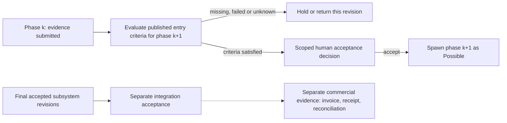

# Synthetic phase nucleation

> [!note]
> Design only. This slice proposes a synthetic, offline evaluator. It does not add a model, live buffer, approval workflow, or financial connector. Existing encoder interfaces remain ports only. No deployment, real records, or process-validity claims.

## Purpose

Let a reviewer trace a proposed handoff across two fictional subsystems: what was measured, what was inferred, what evidence the next phase requires, and who could accept or return the current revision. Keep measurements, graph proposals, authority, and commercial observations separate. See [docs-first design](../DOCS_FIRST.md) and [data policy](../../DATA_POLICY.md).

## Field to graph

1. Generate a pinned numerical velocity field. Record seed, time, grid, boundary, configuration, method, and tolerances. The tracer ring records simulated geometry; it is neither an event ring nor a process-domain `Buffer`.
2. Sample signed vorticity, absolute vorticity, speed, strain versus spin, dwell and dye. Apply a declared transform to selected columns, then fit standardization and PCA on training trajectories only when evaluating a model. The frozen two-dimensional projection is a viewing aid. Cluster in the standardized feature space and retain the original readings and coordinates. Report retained variance; do not interpret proximity as a dependency.
3. On the original field, locate candidate critical cells by winding and compare with the sign of the local velocity Jacobian determinant. A negative determinant indicates a saddle at a nondegenerate critical point. A positive determinant alone does not certify a vortex or stability. A traced lane or same-spin pair is a candidate, never a process edge. A feature-map Jacobian singular value measures local sensitivity, not a dynamical eigenvalue, Lyapunov exponent, or barrier certificate.
4. In a separate typed phase graph, map only declared synthetic evidence to capabilities (process plus resource), operands (objects, never people), declared buffers, phase revisions and acceptance checks. Keep geometry links, proposed process links and evidence-backed links separate. Use the [capability graph](HFGT_CAPABILITY_GRAPH.md) translation-gap and candidate-edge patterns; reuse the [probe](PROBE.md) label seam with the reading digest. A human label can resolve a candidate or register a disagreement. It cannot issue an acceptance decision. The [CNN/GNN ports](CNN_GNN_PIPELINE.md) may later rank candidates via typed inputs and array-free tensor references. Do not use post-decision features, including gate values influenced by the outcome.

## Phase boundary

The next phase's versioned entry criteria are available before the prior phase is accepted; no future execution or state is a prerequisite for that check. A `governs` edge points from that published check to the prior phase revision. It is not a forward scheduling dependency and never rewrites history. After a scoped human acceptance, a bounded rule can propose the next phase as `Possible`; a new phase is not automatically released. A later issue can open a new revision or exception without mutating the old acceptance. Forward `nucleates` and `requires_accepted` dependencies must be acyclic; check them separately from `governs` links and intra-phase rework.

Suggested contract records:

| Record | Required meaning |
| --- | --- |
| Phase revision | Opaque phase, subsystem and revision IDs; entry-profile version and required predecessor revisions. |
| Reading or candidate | Source and version, mapping and configuration digests, sample coordinates if synthetic, method, tolerances, validity and run reference. |
| Phase transition event | Prior and next state, phase revision, sequence, event and idempotency keys, input digest, transition-policy version, evidence and any required decision reference. |
| Acceptance decision | Exact revision, scope, authorized role, evidence references, rationale, decision time and any conditions or expiry. |
| Ledger observation | Offline fixture only: independent source revision, observation time and invoice, receipt or reconciliation status. No event writes or payment logic. |

Append transitions with deterministic replay. Repeating the same key and input digest is a no-op; a changed input under the same key is a conflict. Unknown, inaccessible, stale and failed evidence stay distinct. Neither readiness nor an accepted subsystem proves integration acceptance. Invoiced, received and reconciled are separate observations, not consequences the simulator can assert.

## Synthetic evaluation

Start with two subsystems, three phases each, one cross-subsystem dependency, one return for rework, and an independently supplied commercial observation. Use `Possible`, `Conditional`, `Ready` and `Executing` as transient simulator states and `Accepted` as an absorbing state for a fixed revision. A simulated acceptance is tagged synthetic and cannot produce an authority record. If the transient matrix $Q$ has spectral radius below one, solve $(I-Q)t=\mathbf{1}$ for expected steps to absorption and $(I-Q)b=c$ for expected cumulative cost with a declared per-step cost vector $c$. Steps are not calendar duration. If other terminal states are added, distinguish expected time to any terminal state from probability of acceptance. Coupled subsystems require a joint state or discrete-event replay; do not add per-phase means to predict project duration. Rates are illustrative until validated process mapping and event history exist.

## Acceptance checks before implementation is accepted

- Reproduce the pinned field, feature transforms, candidate readings, replay sequence and output digest. Keep whole trajectories separate in train and test; compare with a no-event control and a non-learning baseline before claiming added value.
- Reject invalid transition rows, unreachable absorption, dependency cycles, missing prerequisite revisions, and execution or acceptance transitions without the required scoped decision in the governance trace. Check the analytical toy result against a seeded Monte Carlo run. The simulation trace and governance trace are distinct.
- A frozen successor entry check can hold or return its predecessor; replay must not backdate or overwrite acceptance. Duplicate inputs do not double-spend simulated budget or spawn duplicate next phases.
- Confirm that geometric proximity, scores and labels cannot write confirmed edges, release work, or create ledger observations. Cash reconciliation may appear only from the separately supplied observation, not from a phase outcome.
- Before any use beyond synthetic fixtures, test two worlds that differ only in a restricted label or source record. To an unauthorized reviewer, derived counts, graph shape, scores, caches and exports must not reveal which world is present. Recheck source authorization before deriving or returning results, including after revocation; authorize positive controls separately. This document does not certify a permission boundary.

## Build order after design review

Design page, described contracts and generated reference, array-free port, deterministic infrastructure adapter, then synthetic fixture and regression tests. Evaluate the non-learning baseline before proposing an encoder or a viewer integration. No software behavior changes in this PR.
