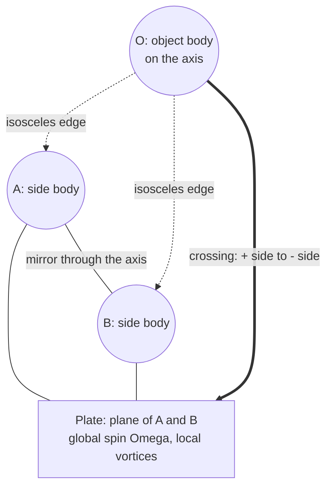

# Plate and spatial isosceles three-body

> [!warning] Simulated, not computed
> Every result here has `epistemic_status="simulated"`. Positions are model state, not business locations. A plate crossing is a **candidate** handoff, never a release.

## Purpose

A **plate** is a 2D field with a **global spin** and **local vortices**. A spatial isosceles three-body system is attached to it:

- two mirrored **side bodies** A and B (equal mass) define the plate: its height, phase and spin;
- one **object body** O rides the plate normal (the symmetry axis) and **crosses the plate**, moving between its `+` and `-` sides.

The crossing is how an object passes between plates: each crossing is published to the [message broker](../architecture/MESSAGE_BROKER.md), and a router may turn it into a candidate handoff to another plate.

## Geometry and equations

Bodies, with the centre of mass fixed at the origin and $G = 1$:

$$A = (r\cos\theta,\ r\sin\theta,\ z),\quad B = (-r\cos\theta,\ -r\sin\theta,\ z),\quad O = (0,0,w),\quad 2mz + m_3 w = 0$$

- Object height over the plate: $\zeta = w - z$. Side: `+` when $\zeta > 0$.
- Plate phase $\theta$ (inertial, unwrapped) and rate $\Omega = \dot\theta$.
- Global spin $L_z = \sum_i m_i (x_i \dot y_i - y_i \dot x_i) = 2 m r^2 \Omega$, conserved by the axial symmetry.
- Forces: Plummer-softened gravity, $a_i = \sum_j m_j (x_j - x_i) / (|x_j - x_i|^2 + \varepsilon^2)^{3/2}$.
- Integrator: velocity Verlet (symplectic, time-reversible).
- Start: side speed $s \cdot v_c$ with $v_c^2 = r\left(\frac{m}{4r^2} + \frac{m_3 r}{(r^2 + \zeta_0^2)^{3/2}}\right)$.

**Local vortices** live in the plate frame (Rosenhead-Moore regularised point vortices, core $\delta$):

$$u_p(x) = \sum_k \frac{\Gamma_k}{2\pi} \frac{J(x - x_k)}{|x - x_k|^2 + \delta^2},\qquad J(a, b) = (-b, a)$$

In the inertial frame, at plate phase $\theta$: $u(x) = \Omega J x + R_\theta\, u_p(R_\theta^{\top} x)$.

## Arc derivative bound (for certified winding)

For $K(x) = x / (|x|^2 + \delta^2)$ with $s = |x|^2 + \delta^2$, the Jacobian $(sI - 2xx^{\top})/s^2$ has eigenvalues $1/s$ and $(\delta^2 - |x|^2)/s^2$, both of magnitude at most $1/s$. Rotation by $J$ or $R_\theta$ preserves the norm. So on a ring segment $e$:

$$\sup_e \left\|\frac{du}{ds}\right\| \le B_e = |\Omega|\,[\text{inertial}] + \sum_k \frac{|\Gamma_k|}{2\pi\,(d_{k,e}^2 + \delta^2)}$$

where $d_{k,e}$ is the **exact** distance from vortex $k$ to the arc $e$. This is a whole-arc bound, not an endpoint Jacobian. It is passed with its provenance to the existing [velocity winding](VELOCITY_WINDING.md) certificate, which stays conditional on that bound.

## Event-driven, no resets

Object mass can change during a run (`ObjectMassEvent`), for example when a gate's held load changes. The run **continues**: positions and velocities are kept, the centre of mass is re-centred, and the energy and spin baselines are reset for drift reporting. Nothing restarts from $t = 0$, and snapshots are always **inertial** (the co-rotating frame would discard the plate phase).

## Contracts

| Contract | Role |
| --- | --- |
| `IsoscelesParams` | masses, side radius, spin factor, start height and rate, softening |
| `PlateVortex` | one local vortex in the plate frame, strength given explicitly |
| `ObjectMassEvent` | live object-mass change at time `t`, with a cause |
| `PlateRunRequest` | plate id, object id, params, vortices, step settings, events |
| `PlateRunResult` | inertial trajectories and plate readouts as `TensorRef`s, crossings, drift and symmetry diagnostics |
| `PlateCrossing` | time (interpolated), direction, side, plate height and phase, radial offset |
| `RingWindingRequest` | ring on the plate for a velocity-index reading, plate or inertial frame |

Plate readout features (axis `feature` of `PlateRunResult.plate`): `height`, `phase`, `omega`, `side_radius`, `angular_momentum_z`, `zeta`, `zeta_dot`, `energy`, `mirror_error`.

Ports: `PlateDynamicsPort`, `PlateFieldPort`, `ArcBoundPort`. Service: `PlateService` (runs, publishes events, composes ring winding). Arrays exist only in `app.infrastructure.plate`.

## Acceptance tests

1. Energy error is bounded and **second order**: below $10^{-5}$ at `dt = 0.002` on the default run, and halving `dt` cuts it by about 4 (ratio between 3.5 and 4.5). $L_z$ drift stays below $10^{-9}$ (the axial symmetry conserves it exactly).
2. Mirror symmetry holds: `max_mirror_error` below $10^{-9}$.
3. Time reversal: run forward, flip velocities, run back; positions return within $10^{-8}$.
4. A mass event continues the run (no reset) and is reported once.
5. Plate-frame field matches a finite-difference Jacobian; the arc bound dominates densely sampled $\|du/ds\|$.
6. A ring around one vortex certifies index `+1` **whatever its spin sign** (velocity index is not circulation sign). A ring around an opposite-spin pair certifies `+2`: each regularised core has index `+1` and no saddle sits between them. A ring around no vortex certifies `0`. Undersampled rings stay `sampled_only`. A spin-dominated inertial ring certifies `+1`.
7. Every crossing is published once to `plate/<plate_id>/crossing`, followed by one `plate/<plate_id>/run` summary.

## Example (doctest)

>>> import sys; sys.path.insert(0, "src")
>>> from app.application.plate import IsoscelesParams, ObjectMassEvent, PlateRunRequest, PlateVortex, RingWindingRequest
>>> from app.infrastructure.plate import build_numpy_plate
>>> service, store, broker = build_numpy_plate()
>>> vortices = (PlateVortex(id="v1", u=0.6, v=0.0, strength=1.0), PlateVortex(id="v2", u=-0.5, v=0.4, strength=-0.8))
>>> req = PlateRunRequest(plate_id="plate-a", object_id="obj-1", params=IsoscelesParams(object_mass=0.3),
...                       vortices=vortices, steps=15000, dt=0.002, record_every=50,
...                       mass_events=(ObjectMassEvent(t=15.0, object_mass=0.5, cause="synthetic load change"),))
>>> run = service.run(req)
>>> run.frame, run.epistemic_status, run.status
('inertial', 'simulated', 'ok')
>>> len(run.crossings) > 0, run.max_relative_energy_drift < 1e-5, run.max_mirror_error < 1e-9
(True, True, True)
>>> run.mass_events_applied
(15.0,)
>>> store.get(run.plate).shape[1] == len(run.feature_names)
True
>>> topics = [e.topic for e in broker.replay("plate/plate-a/#")]
>>> topics.count("plate/plate-a/crossing") == len(run.crossings), topics[-1]
(True, 'plate/plate-a/run')
>>> service.ring_winding(RingWindingRequest(vortices=vortices, center=(0.6, 0.0), radius=0.3, samples=128)).certified_index
1
>>> service.ring_winding(RingWindingRequest(vortices=vortices, center=(0.6, 0.0), radius=0.3, samples=4)).status
'sampled_only'

## Limits

- Vortices are pinned in the plate frame (no Kirchhoff vortex dynamics yet), and bodies are **passive** with respect to the field: there is no coupling arm. A coupled arm is a separate, unproven hypothesis.
- One plate per run. Passage between plates is a broker handoff, not a multi-plate physical simulation.
- The winding certificate is conditional on the analytic bound and on the regularised vortex model being the field of interest.
- No embedding-to-plate mapping is shipped. Placing vortices from embeddings requires a frozen, versioned projection with explicit strengths.
