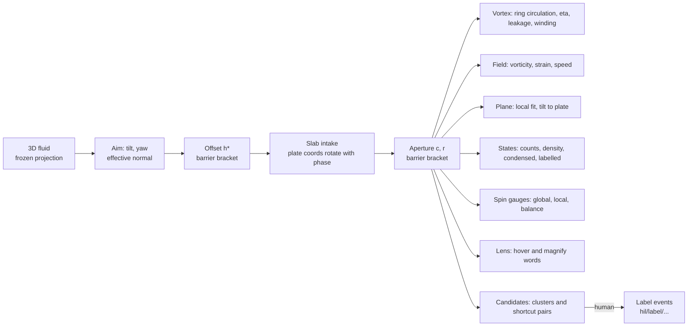
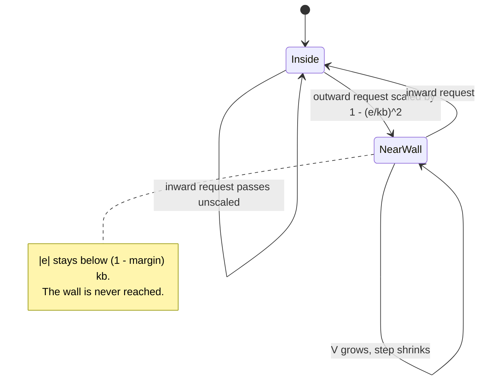

# Probe: aperture, spin gauges, barrier brackets, lens and labels

> [!note] Backend only
> This slice is the implementation layer a probe UI calls: measure, move within a bracket, hover and magnify, cluster into candidates, record labels. No UI ships here.

> [!warning] What the readings are
> Plane and state readings are **embedding geometry**. Vortex, field and spin readings come from a **model field**: regularised point vortices at slab records with **explicitly supplied strengths and evidence**. Spin is never inferred from PCA handedness. Nothing here is a process fact or an authority.

## The picture

A **2D plate** sits inside the **3D fluid** (a frozen 3D projection of the embedding). The plate takes in data as it moves:

1. **Aim.** The base normal $n$ is re-aimed by the aperture's tilt $\beta$ and yaw $\psi$ (precession about $n$): $n' = \cos\beta\, n + \sin\beta(\cos\psi\, a_1 + \sin\psi\, a_2)$.
2. **Offset.** The plate passes through $o + h^* n'$.
3. **Spin.** In-plane axes rotate by the plate phase $\theta$. Records are fixed in the fluid, so in plate coordinates they sweep past the aperture as the plate spins.
4. **Slab.** Records with $|(x - o)\cdot n' - h^*| \le w$ are taken in, at plate coordinates $(u, v)$.
5. **Aperture.** A disc of radius $r$ centred at $c$ in plate coordinates. Magnification $m$ narrows the **lens** to $r/m$.

## Readings (independent masks)

On the aperture ring (K samples), with $L = \nabla u$, $S = (L + L^{\top})/2$, $\Omega = (L - L^{\top})/2$:

| Reading | Definition | Mask |
| --- | --- | --- |
| circulation | $\oint u \cdot t\, ds$ | none (signed) |
| $\eta_{kin}$ | $\int \|\Omega\|_F^2 ds / \int (\|\Omega\|_F^2 + \|S\|_F^2) ds$ | denominator below `gradient_floor` x ring length |
| leakage | $\int |u\cdot e_r| ds / \int (|u\cdot e_r| + |u\cdot e_\varphi|) ds$ | integrated speed below `speed_floor` x ring length |
| winding | velocity index, `certified` only under the analytic whole-arc bound | its own guards (see [velocity winding](VELOCITY_WINDING.md)) |

Squared-gradient measures are not physical energies. A point vortex shows why the readings stay separate: outside its core it encloses full circulation, but the local flow is irrotational strain, so $\eta \approx 0$ there. Zero leakage does not imply neutral stability or attraction.

**Analytic controls** (unit amplitude, centred ring), which the tests reproduce:

| Field | $\eta_{kin}$ | index | leakage |
| --- | --- | --- | --- |
| rotation $(-y, x)$ | 1 | +1 | 0 |
| simple shear $(y, 0)$ | 0.5 | invalid (crosses stagnation) | $2/(2+\pi) \approx 0.389$ |
| saddle $(x, -y)$ | 0 | -1 | 0.5 |
| translation $(1, 0)$ | masked | 0 | 0.5 |
| dilation $(x, y)$ | 0 | +1 | 1 |

**Field** (grid inside the aperture): mean vorticity, mean strain $\|S\|_F$, max speed; points below `speed_floor` masked.
**Plane**: PCA of aperture records in 3D: planarity $1 - \lambda_{min}/\lambda_{mid}$ and the unsigned tilt of the local plane to the plate.
**States**: records total, in slab, in aperture, with strength, condensed (from an enrichment run), labelled; aperture-to-slab density ratio.
**Spin gauges**: global spin $\Omega$ (plate), local spin $\bar\omega / 2$ in the aperture, positive and negative circulation of vortices inside, balance $(\Gamma_+ - \Gamma_-)/(\Gamma_+ + \Gamma_-)$.

## Barrier brackets (Barrier Lyapunov Functions)

The human brackets a search window $[lo, hi]$ for the plate offset $h^*$ and for the aperture radius $r$. With centre $c = (lo + hi)/2$, half-width $k_b = (hi - lo)/2$ and error $e = s - c$:

$$V(e) = \tfrac12 \ln \frac{k_b^2}{k_b^2 - e^2}$$

$V$ is 0 at the centre and grows without bound at the walls: it is the gauge of **distance to the bracket**. A human velocity request $v$ is filtered as

$$\dot e = v\left(1 - \frac{e^2}{k_b^2}\right) - k\,e$$

when $v$ pushes outward (inward requests pass unscaled), with optional centring gain $k \ge 0$. Then $\dot V = \frac{e\,\dot e}{k_b^2 - e^2} = \frac{e v}{k_b^2} - \frac{k e^2}{k_b^2 - e^2}$, which is bounded for outward motion, so $V$ stays finite and $|e| < k_b$ in continuous time.

**Exact integration.** Outward motion is integrated with its closed form

$$e(t) = k_b \tanh\!\left(\operatorname{atanh}(e_0/k_b) + v\,t/k_b\right)$$

which satisfies $\dot e = v(1 - e^2/k_b^2)$ and approaches but never reaches $k_b$, however large $v t$ is. Inward motion is linear until the centre, then continues outward by the same formula. The centring gain is applied by operator splitting as $e \leftarrow e\,e^{-k h}$, which only shrinks $|e|$. A final clamp keeps $|e| \le (1 - \text{margin})\,k_b$ against floating-point saturation of $\tanh$. The window is never left, and the cost of a move does not depend on how hard the human pushes.

## Lens: hover and magnify

`lens(pointer, magnification)` returns the records within $r/m$ of the pointer (plate coordinates), the hovered record (nearest), its own top terms (tf x idf over the slab), and the lens's **contrast terms**: smoothed log-odds of each term in the lens against the slab. Terms come from record titles (CamelCase split) and optional text.

## Candidates and labels

`candidates()` clusters the aperture records by mutual kNN in 3D (components of at least `min_size`), names each cluster by its contrast terms against the aperture, and lists enrichment **shortcut pairs** whose two ends are both in the aperture. All are `status="candidate"`. Optionally only **condensed** records (nonzero sparse code) are clustered.

A human turns a candidate into a `LabelEvent` (record, cluster or pair target; label key; labeler role; blind flag; real timestamp; the digest of the reading it was made on). `LabelBook` validates targets, publishes `hil/label/<target_kind>` events (`hil.label`, computed) and reports conflicts. A label is a human judgment on a candidate. It is not validation of the field, and it grants no authority.

## Contracts

| Contract | Role |
| --- | --- |
| `Bracket`, `BracketState`, `BracketStep` | BLF search windows and moves |
| `RecordStrength`, `RecordText`, `ProbeCloud` | frozen 3D projection, explicit strengths with evidence, text, optional enrichment |
| `PlatePose`, `Aperture`, `ProbeRequest` | aim, offset, phase, spin, slab, aperture, brackets, floors |
| `ProbeReading` | ring, field, plane, states, spin, bracket states, aperture ids, slab coordinates |
| `LensRequest`, `LensReading`, `TermWeight`, `LensRecord` | hover and magnify |
| `CandidateRequest`, `CandidateCluster`, `PairCandidate`, `CandidateSet` | clusters and shortcut pairs |
| `LabelEvent` | human label record |

Ports: `ProbePort`, `LensPort`, `CandidatePort`. Services: `ProbeService`, `LabelBook`, `bracket_step`. Arrays live only in `app.infrastructure.probe`.

## Acceptance tests

1. Ring kernel reproduces every analytic control in the table, including the masked translation $\eta$ and the invalid shear winding.
2. A single vortex at the aperture centre: leakage $\approx 0$, circulation equal to the regularised enclosed value with the vortex's sign, winding certified $+1$ for either sign. Outside the core the flow is irrotational, so $\eta \approx 0$ on that ring despite full circulation; inside the core $\eta \approx 1$. Circulation and $\eta$ are independent readings.
3. Bracket: 10 000 maximal outward pushes never leave the window; $V$ stays finite; inward requests pass unscaled; a request starting outside the window is rejected.
4. Rotating the plate phase by $\delta$ rotates slab coordinates by $-\delta$; tilt 0 leaves the normal unchanged.
5. Lens contrast ranks terms that are frequent in the lens and rare in the slab first.
6. Two well-separated groups in the aperture become two candidate clusters with distinct suggested terms.
7. Labels: unknown targets rejected, conflicts reported, events published once with a real timestamp.

## Example (doctest)

>>> import sys; sys.path.insert(0, "src")
>>> import numpy as np
>>> from datetime import datetime, timezone
>>> from app.application.probe import (Aperture, Bracket, LabelEvent, LensRequest, CandidateRequest, PlatePose,
...                                    ProbeCloud, ProbeRequest, RecordStrength, RecordText, bracket_step)
>>> from app.infrastructure.probe import build_numpy_probe, put_cloud
>>> rng = np.random.default_rng(2)
>>> A = np.c_[rng.normal(-0.6, 0.08, 30), rng.normal(0, 0.08, 30), rng.normal(0, 0.03, 30)]
>>> B = np.c_[rng.normal(0.6, 0.08, 30), rng.normal(0, 0.08, 30), rng.normal(0, 0.03, 30)]
>>> ids = tuple(f"r{i:02}" for i in range(60))
>>> titles = ["GateDecision"] * 30 + ["PurchaseOrder"] * 30
>>> service, store, broker = build_numpy_probe()
>>> cloud = ProbeCloud(cloud_id="demo", ids=ids, positions=put_cloud(store, np.vstack([A, B])), projection_ref="synthetic pc1-3 v1",
...     strengths=(RecordStrength(id="r00", strength=1.0, source_ref="synthetic"),),
...     texts=tuple(RecordText(id=i, title=t) for i, t in zip(ids, titles)))
>>> req = ProbeRequest(cloud=cloud, pose=PlatePose(origin=(0, 0, 0), normal=(0, 0, 1), slab_half_width=0.2),
...     aperture=Aperture(center=(0.0, 0.0), radius=1.0),
...     offset_bracket=Bracket(lo=-0.5, hi=0.5), radius_bracket=Bracket(lo=0.2, hi=2.0))
>>> reading = service.measure(req)
>>> reading.states.in_slab, reading.states.in_aperture, reading.result_kind
(60, 60, 'embedding_geometry')
>>> lens = service.lens(LensRequest(probe=req, pointer=(0.6, 0.0), magnification=4))
>>> lens.hovered.title, sorted(t.term for t in lens.contrast_terms[:2])
('PurchaseOrder', ['order', 'purchase'])
>>> sorted(tuple(sorted(c.suggested_terms[:2])) for c in service.candidates(CandidateRequest(probe=req)).clusters)
[('decision', 'gate'), ('order', 'purchase')]
>>> step = bracket_step(Bracket(lo=-0.5, hi=0.5), value=0.45, velocity=100.0, dt=1.0)
>>> step.value < 0.5, step.state.at_wall
(True, True)

## Limits

- The field is a model: vortex readings depend entirely on the supplied strengths. Records without strengths contribute to states and planes only.
- The plate basis is deterministic from the effective normal; phase is relative to it. Re-aiming (tilt, yaw) changes the slab, so readings at different aims are different measurements, not one gauge.
- Mutual-kNN clustering is a candidate generator, not a validated clustering. Contrast terms describe vocabulary, not meaning.
- Brackets guarantee the probe stays in the human's window; they say nothing about whether the window is the right one.
