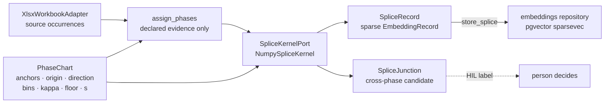

# Sparse phase splice

> [!warning] A similarity lens, not a process fact
> The splice places workbook source occurrences in a sparse space where **lifecycle phase** weights similarity through declared **phase parameters**. A junction it reports is a candidate for a person to label. It never creates a relation, a dependency, an approval or an allocation, and the chart angle is not the simulator's plate phase.

## Where it sits



## Two phases, never one

| | Lifecycle phase | Chart angle |
| --- | --- | --- |
| What | phase code read from the workbook (`phase_code = "2"`) | declared coordinate on a circle |
| Who sets it | the source | the chart owner, versioned, with `provenance` |
| Used by | WBS outline, promotion to `Phase` | splice similarity weighting only |
| Not | the plate phase theta | a schedule, an order or a dependency |

Template order may be used to *space* anchors (`PhaseChart.uniform`). That is an ordering choice recorded in the chart, never a `DEPENDS_ON`.

## Phase evidence

First rule whose `kind` matches wins. Anything else is `unphased`.

| Source | Reads | Never |
| --- | --- | --- |
| `field` | one field (e.g. `phase_code`); integral floats become ints | blank, bool or fractional values |
| `relation` | one hop over declared relation types (e.g. `budget_for`) to a target whose own rule is `field` | chains, targets outside the batch |
| `per_phase_hours` | `ph{code}_raw`-style fields; shares proportional to hours > 0 | blank or zero as evidence (blank never becomes zero) |

A code with no chart anchor leaves the object unphased and adds an `unanchored_phase_code` diagnostic. Several codes make the object `mixed`.

## The space

Per block width `D = text_dim`; `B = bins`; dimension `(B + 1) * D` (at most 65536).

- **Content** `c`: words of title + text (weight 1) plus slot tokens `f:<field>=<value>` and `r:<relation type>` (weight `slot_weight`; relation targets are never hashed). Same signed blake2b hash as the ingest tensorizer, signed `log1p`, L2-normalised.
- **Bins** for a phase at chart angle `a`: `w_b ∝ exp(kappa (cos(phi_b - a) - 1))`, `phi_b = 2 pi b / B`; bins below `floor * max(w)` are dropped, the rest renormalised. Mixed objects use the share-weighted mixture.
- **Spliced vector**: block 0 carries `sqrt(s) c`; block `1 + b` carries `sqrt((1 - s) w_b) c`. Unphased objects put everything in block 0 (`s = 1`). Every vector has unit norm.

So the cosine factorises exactly:

```text
spliced(x, y) = content(x, y) * K(x, y)
K(x, y)       = sqrt(s_x s_y) + sqrt((1 - s_x)(1 - s_y)) * sum_b sqrt(w_xb w_yb)
```

The sum is the Bhattacharyya coefficient of the two bin distributions.

| Pair | K |
| --- | --- |
| same phase | 1 |
| different phases | `s + (1 - s) BC`, falls with chart distance as kappa grows |
| phased and unphased | `sqrt(s)` |
| two unphased | 1 |
| `kappa = 0` | 1 everywhere (phase ignored) |
| `s = 1` | 1 everywhere (phase ignored) |
| `s = 0`, kappa large | 0 across phases; unphased objects orthogonal to phased ones |

## Setting phase parameters

| Parameter | Effect | Start |
| --- | --- | --- |
| `anchors[].angle_deg` | where each phase sits; nearer phases couple more | uniform in template order |
| `origin_deg`, `direction` | rotate or mirror the whole chart; pairwise coupling is unchanged at bin multiples | 0, ccw |
| `bins` | angular resolution; 12 matches the enrichment phase bins (30 degrees) | 12 |
| `concentration` (kappa) | how sharply phases separate | 4 |
| `floor` | sparsity cut on weak bins | 0.05 |
| `shared_weight` (s) | how much any two objects stay comparable regardless of phase | 0.25 |
| `provenance` | required: who set the values and why | |

Every value is part of `SpliceProfile.digest()`, and `space().model_version` pins that digest. Changing a parameter makes a new embedding space, so vectors from two charts are never compared or overwritten.

## Junctions

A junction pairs two objects whose dominant phases differ and whose content cosine reaches `junction_min_content`. It reports content similarity, phase coupling, spliced similarity, chart distance and shared words. Ranking is by spliced similarity. `junction_kinds` limits which kinds may pair (for example tasks only, leaving subtotal rows out). Status is always `candidate`.

## Limits

- Hashing features, not a learned embedding model. Collisions are possible at small `text_dim`.
- Phase evidence is only as good as the adapter's phase codes; leaf parents in the workbook are still proposals.
- Junctions are content overlap across phases. Repeated boilerplate (the same task name in two phases) is the expected top hit and still means nothing until a person labels it.
- No messaging events, no automatic promotion, no write to the probe or plate.

## Contract reference

Generated: [Agency contracts](../contracts/AGENCY_CONTRACTS.md#sparse-phase-splice).
