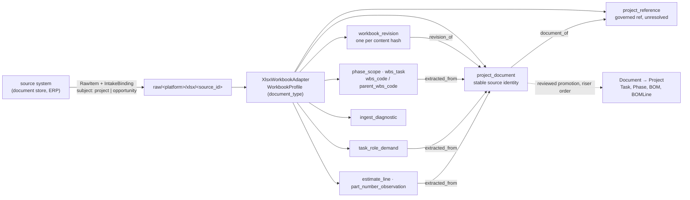

# XLSX workbook adapter

> [!warning] Source occurrences, not entities
> The adapter reads a known workbook template into `DomainObject` records. Each record is a source occurrence keyed by revision + locator. It is not a canonical `app.domain` entity, an approval, an allocation, an assignment or a schedule.

## Pattern: the estimation workbook is a project document

Three identities, never one:

1. **Source document:** `platform + source_id` (e.g. a document-store item id). Stable across revisions. `project_document` uses it.
2. **Source revision / occurrence:** content SHA-256 + sheet + cell locator. Reproducible within a revision; a new revision gets new occurrence ids.
3. **Business entity:** an opaque id resolved later by a reviewed mapping. The project or opportunity number in `IntakeBinding` is a governed reference, not a graph key.

The binding is supplied at intake by the source system. It is never parsed from a filename, a cell or file metadata. A workbook that arrives without one is still ingested (`binding_state = unbound`) and flagged; only project-scoped claims wait. `revision_label` (for example "Round 1") is supplied, never inferred.

## Task extraction

The task list column carries the WBS. Without outline grouping or a WBS code column, the level of a row is read from text rules confirmed by formatting:

| Level | Row | Evidence |
| --- | --- | --- |
| 1 | phase (root) | phase rule on the text; bold expected |
| 2 | stem task | plain row inside a phase |
| 2 | sub-system heading | inside a sub-system section, indent ≥ `subsystem_min_indent` |
| 3 | leaf task | inside a section, after a sub-system row, indent ≥ `leaf_min_indent`, or named `<CODE> - …` where CODE is a sub-system heading in the same phase |
| – | marker / subtotal / total / copy line | kept as `wbs_row` evidence, never tasks |

- A section opens at `section_start_pattern` (bold italic expected) and closes at the first plain row after it, which returns to stem level.
- Inferred leaf parents (indent/name evidence) remain `proposed_child_of`. Explicit Excel outline grouping wins and emits `child_of` with `parent_status=asserted`. This asserts only the source hierarchy, never business acceptance or execution authority.
- Text and formatting disagreeing is a `formatting_disagrees` diagnostic; the text rule is kept.
- `wbs_code` (`P2`, `P2.05`, `P2.05.01`), `parent_wbs_code` and `wbs_level` form the explicit hierarchy column a task tool needs for import. They are derived per revision from row order (`wbs_code_basis = derived_row_order`): display codes, not identities. `wbs_outline()` projects them for review; no importer is included.
- Sub-system codes resolve only by an exact (case-insensitive) leading code against the declared index. Template placeholders such as "Sub-System A (ex: CODE)" keep the example code with state `placeholder` and never resolve. Identical placeholder labels in two phases stay two occurrences.
- No `DEPENDS_ON` from row order. Phase order is template order only.

## Task x role demand

- One `task_role_demand` per task x role block with any input; blank count and hours produce none (`roles_blank` on the task). A cached zero is never asserted as zero demand. States: `explicit`, `explicit_zero`, `partial`.
- `labor_hours` = count x hours each. Hours are per person, so `elapsed_hours_estimate` = hours each (`elapsed_basis = hours_each_parallel_crew`). A disagreeing cached total is `stale_cached_total`; nothing is recalculated.
- Demand is the commercial estimate layer (`layer = commercial_estimate`, `priced_under` its role column). It is not a skill requirement, an assignment, a booking or actual time.
- Role codes split by `role_code_format` into series, number and year; the year is kept but does not by itself define an effective-date interval.
- `RoleClassRule` marks a block's labor source: `internal`, `contract` or `vendor`. Vendor hours can be `priced_elsewhere` (sold as an equipment line), so they are never priced twice.
- Responsibility values map to party classes. When hours and responsibility disagree, `responsibility_precedence = internal` resolves to internal if internal staff is on either side; the raw value, the conflict and the rule are all kept.

## BOM lines

- One `estimate_line` per quantity-bearing row, classified only by its own cell. A group header above it is `group_label` context and is never carried down.
- When the line's code resolves, `subsystem_candidate` links it to sub-system headings with the same code (a proposal).
- Each part number becomes a `part_number_observation`: a claim (`issuer_claim = manufacturer`, `resolution_status = unmapped`) with a comparison value for candidate matching. Two lines with the same part are two lines and two claims.
- Money stays raw text with its formula. Unit of measure is owned by the ERP item (`uom_authority = external`). Note fields are kept as text for embeddings; URLs are counted, never fetched.

## Rules carried from 0.9.0

Formulas and cached values stay apart; macros are not executed and external links not resolved; unknown layouts are quarantined; defects are diagnostics, never repairs; references into excluded sheets mark dependent totals as partial; same bytes give the same ids and digests, so re-ingest is a ring no-op.

## Promotion into `app.domain`

Promotion is a separate, reviewed step and follows [DOMAIN_DEPENDENCY_GRAPH.md](../domain/DOMAIN_DEPENDENCY_GRAPH.md): an occurrence can be promoted only after its target class, and every class beneath it, has an accepted definition. `project_document` → `Document` tied to `Project` needs `Project` (level 7) and `Document` (level 5). Phases, tasks, BOM and BOM lines wait on `Project`. Task x role demand has no accepted target class yet.

## Acceptance

`tests/test_xlsx_workbook.py`: quarantine; document, reference and revision links; document identity across revisions; unbound documents; binding through the broker; phase/stem/sub-system/leaf levels and codes; placeholder and resolved sub-system codes; markers; formatting disagreement; repeated labels; blank, zero and partial demand; elapsed estimate; stale cache; role-code split and labor sources; responsibility precedence; BOM lines, part-number claims, group headers, sub-system candidates, raw money; defect diagnostics; idempotent re-ingest; revision anchoring; shared-formula shifting. A private check runs only when `DATAMESH_PRIVATE_WORKBOOK` and `DATAMESH_PRIVATE_PROFILE` are set.

## Not done

No graph-database sink, no business-identity reconciliation across revisions, no Decimal money view, no formula recalculation, no `.xls`, no task-tool importer, no skill-requirement extraction, no product-page enrichment.

## Corrected outline edges (0.9.5)

XLSX adapter version 3 makes parent graph relations agree with hierarchy fields. Re-ingesting the same source through the same durable inbox does not automatically recompute old records: the stored inbox marker still suppresses that event. To rebuild affected private data, use a controlled new handler generation and a new replay consumer within retained history, supplying the original profiles/blobs. Handler identity must be explicit; renaming a durable alone does not bypass inbox deduplication. Existing persisted edges are not silently migrated. Review rebuilt object versions before downstream projections consume them.
